# InferDeploy
深度学习模型推理部署

## 背景

针对深度学习任务，基于 PyTorch 进行训练后获得对应模型文件后，在端侧基于 TensorRT/OpenVINO 进行部署。

而在模型的推理部署中，针对不同任务，模型的加载编译流程基本一致，主要差异在于输入模型前后数据的预处理、后处理流程。

该项目框架主要对模型加载编译流程进行封装，针对具体的任务，只需在此基础上重写预处理、后处理流程即可完成部署。

## 特性总览

- **多后端推理**：同一套任务代码（前/后处理）可运行于 TensorRT（GPU）与 OpenVINO（CPU）双后端，`Params.m_eBackend` 一键切换
- **多任务支持**：图像分类、目标检测、检测+分割多任务、医学图像肝脏分割（2D UNet）
- **体数据分割**：完整 CT volume 逐切面批量推理 + CUDA 3D 后处理流水线（3D CCL → 形态学开闭 → 高斯平滑），肝脏 3D 分割的端到端实测记录（含训练/导出、Dice 评估、跨后端一致性、跨域失效分析）见 [`docs/3D肝脏分割部署流程.md`](./docs/3D肝脏分割部署流程.md)
- **量化评估**：modelopt 显式量化（Q/DQ）+ FP32/INT8 精度对比评估工具（匹配率/IoU/置信度差 + 验收线判定），目标检测的端到端实测记录见 [`docs/目标检测部署流程.md`](./docs/目标检测部署流程.md)
- **工程化**：RAII 资源管理、智能指针、分级日志、CPU/GPU 双计时、模型构建全流程封装

## 环境要求

| 组件 | 版本 | 说明 |
| --- | --- | --- |
| CUDA | 12.4+ | 含 cudart/cublas |
| TensorRT | 10.16 | 支持 Blackwell（sm_120）；`deps/TensorRT-10.16/usr` |
| OpenVINO | 2026.x | 可选，`ENABLE_OPENVINO=1` 启用；`deps/OpenVINO/usr` |
| OpenCV | 4.x | 系统安装 |
| 编译器 | 支持 C++17 的 g++、nvcc | |

> GPU 架构：`config/Makefile.config` 中 `ARCH` 需与本机 GPU 匹配；pip 版 TensorRT/OpenVINO 的
> `libnvinfer_builder_resource*.so` 带 executable-stack 标记时，新内核需用
> `patchelf --clear-execstack` 清除后方可加载。

## 构建

```bash
make                 # 编译主程序 bin/trt-infer（含 OpenVINO 后端，若启用）
make quant-eval      # 编译量化评估工具 bin/trt-quant-eval
make volume-seg      # 编译体数据分割工具 bin/trt-volume-seg
make liver3d         # 编译 post3d CUDA 3D 后处理流水线 bin/liver3d
make clean           # 清理
```

构建开关位于 `config/Makefile.config`：`DEBUG`、`SHOW_WARNING`、`ENABLE_OPENVINO`、`APP`。

## 目录结构

```
InferDeploy
├── bin/                    # 可执行文件：trt-infer / trt-quant-eval / trt-volume-seg / liver3d
├── config/                 # Makefile.config（依赖路径、GPU 架构、编译开关）
├── deps/                   # TensorRT-10.16 / OpenVINO / pyenv（Python 依赖环境）
├── include/
│   ├── common/             # ModelParam（Params/枚举/Dims）、ModelCfg
│   ├── core/               # InferBase、TrtBackend、OvBackend、Calibrator
│   ├── tasks/              # Worker、YoloClassifier/YoloDetector/YoloMultitask/UnetSegmenter、TaskUtils
│   └── utils/              # Logger、Timer、Process（CPU/GPU 预处理）、FileUtil、CudaCheck
├── src/                    # 与 include 对应的 .cpp/.cu 实现
├── samples/                # sample.cpp、quant_eval.cpp、volume_seg.cpp
├── post3d/                 # CUDA 3D 后处理子模块（CCL/形态学/高斯，独立 nvcc 构建）
├── data/
│   ├── models/             # 导出/量化/准备脚本（export_yolo.py、quantize_yolo.py、prepare_volume.py 等）与 onnx/engine
│   └── source/             # 测试图像、CT/MR 切片、体数据
├── calibration/            # INT8 校准数据列表
└── docs/                   # 量化原理（量化.md）、目标检测部署实测、3D 肝脏分割部署实测、插图生成脚本（tools/）
```

## 快速开始

```bash
cd ./bin

# 多任务（检测+分割），TensorRT 后端
./trt-infer ../data/models/onnx/yolov8n-seg.onnx ../data/source/crowd.jpg

# 切换 OpenVINO 后端
./trt-infer ../data/models/onnx/yolov8n-seg.onnx ../data/source/crowd.jpg ov

# 肝脏 CT 分割（2D UNet，第 4 参数 seg 指定分割任务）
./trt-infer ../data/models/onnx/liver-unet.onnx ../data/source/ct_liver/lits_v280.tif_z280.png trt seg

# 体数据逐切面分割 + 3D 后处理
./trt-volume-seg ../data/models/onnx/liver-unet.onnx \
    ../data/source/ct_liver/kaggle_seq128 ../data/source/result/kaggle_seq128 \
    trt --post3d --keep-largest

# FP32/INT8 量化精度评估
./trt-quant-eval multi ../data/models/onnx/yolov8n-seg.onnx ../data/source/image_list.txt
```

> 注意：工具默认按 `bin/` 为工作目录解析相对路径（`../data`、`../calibration`、`../engine`、`../result`）。

## 整体架构

### 架构总览

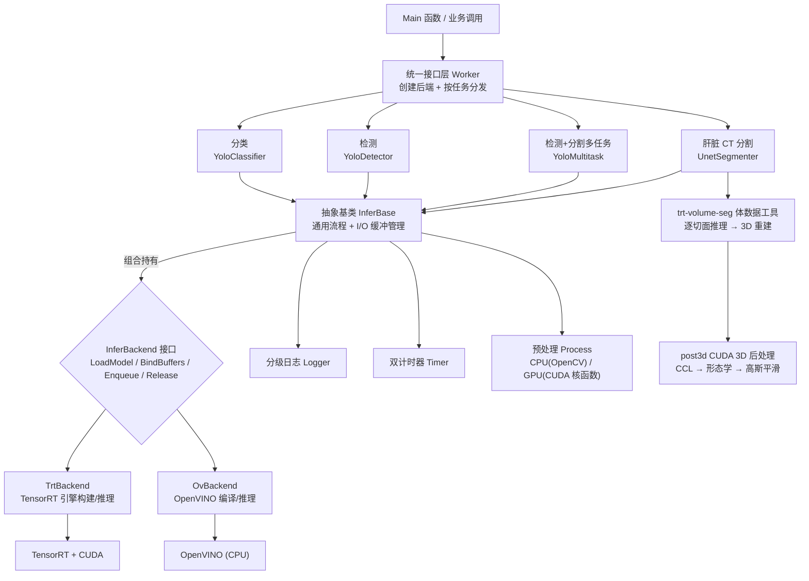

### 继承与组合关系

- **任务类**（Classifier/Detector/Multitask/UnetSegmenter）继承 **InferBase** 抽象基类（后端无关），通过组合持有具体后端
- **TrtBackend / OvBackend** 实现 **InferBackend** 接口
- **Logger** 继承 TensorRT 的 **ILogger** 接口

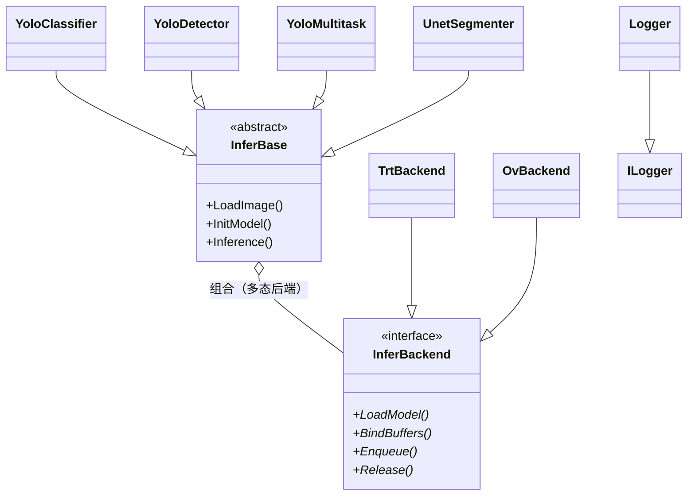

### 组合关系

- **Worker** 按 `Params.m_eBackend` 创建后端实例，按 `Params.m_eTask` 创建对应任务对象
- **InferBase** 持有 Params、Logger、Timer、CUDA stream、I/O 缓冲与 `IoMeta` 元信息
- **TrtBackend** 持有 Runtime/Engine/Context 等 TensorRT 运行时组件
- **Detector / Multitask / UnetSegmenter** 持有检测结果（bbox/mask）对象

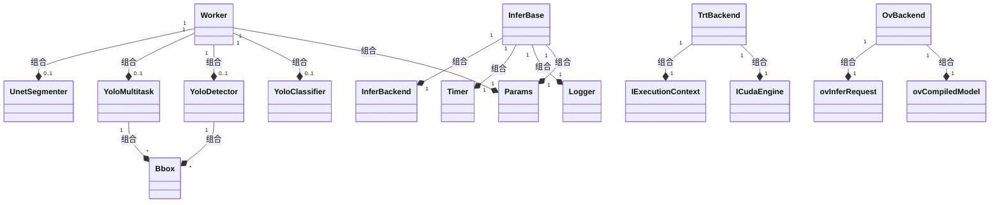

## 通用执行流（InferBase）

所有任务共享同一执行流，后端与任务差异分别由 `InferBackend` 与任务类重写点承载：


## 各任务流程图

### 分类任务（YoloClassifier）

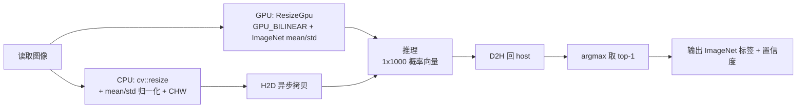

### 检测任务（YoloDetector，YOLOv8）

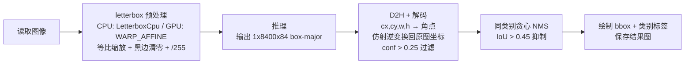

### 多任务（YoloMultitask，YOLOv8-seg 检测+分割）

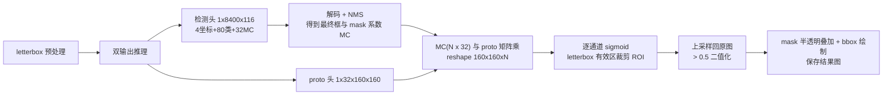

### 肝脏 CT 分割（UnetSegmenter，2D UNet）

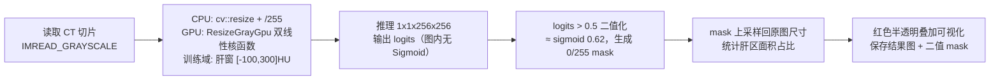

### 体数据逐切面分割 + CUDA 3D 后处理（trt-volume-seg + post3d）

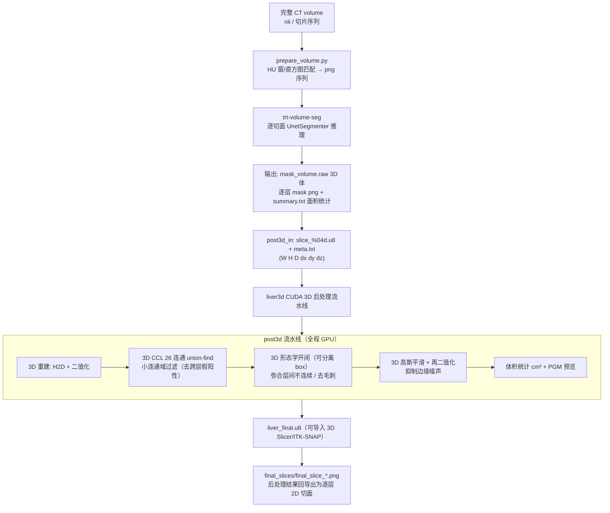

### INT8 量化与精度评估（trt-quant-eval）

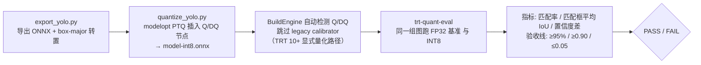

## 模型框架介绍

### 用户调用接口

```c++
// 指定参数：模型文件路径、日志等级、模型构建参数（含后端与任务类型）
auto p_worker = CreateWorker(str_onnx_path, e_level, c_params);

// 指定待推理图片, 进行推理
p_worker->Inference(str_img_path);
```

### Worker 类，提供外部调用接口

- 作用：保证代码的可读性，只对用户可见必要接口
- 提供接口：
  - 构造函数：按 `m_eBackend` 创建推理后端（TrtBackend/OvBackend），按 `m_eTask` 创建对应任务对象
  - 执行推理：`InitModel → LoadImage → Inference` 三步编排

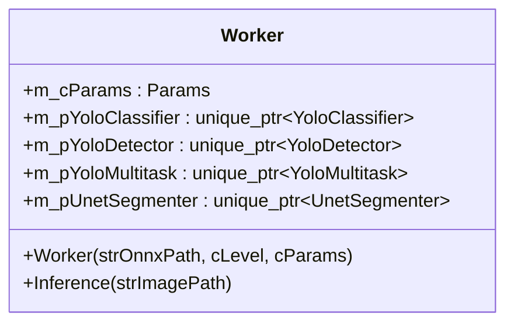

### InferBase 抽象基类，核心框架

- 作用：
  - 后端无关的推理基类，封装通用执行流与 I/O 缓冲管理
  - 提供预处理、后处理、缓冲分配接口，具体任务类继承后重写
- 提供接口：
  - `LoadImage`：记录图像路径与推理信息
  - `InitModel`：`LoadModel → SetupIoBuffers → BindBuffers`（首次）/ `ResetTask`（复用）
  - `Inference`：`Preprocess → Enqueue → Postprocess`
  - `GetPrec`：精度后缀（engine 命名）
  - `Get*HostPtr / Get*DevicePtr`：缓冲地址访问器（多输出任务类可重写）

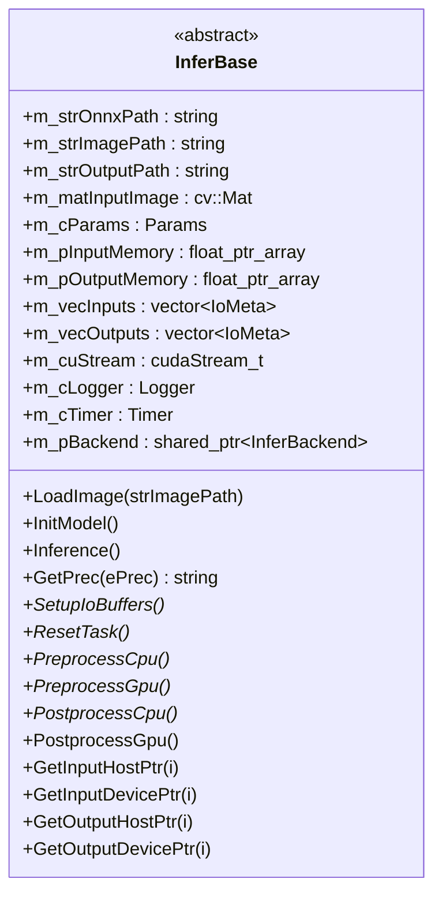

### InferBackend 后端接口与实现

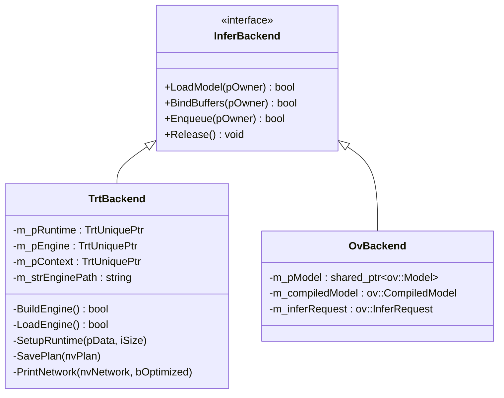

- **TrtBackend**：`.engine` 存在则直接反序列化加载；否则从 `.onnx` 构建
  （`builder → network → config → parser → serialize`），FP16/INT8 精度、
  Q/DQ 显式量化检测、legacy calibrator、FP32 敏感层回退均在此实现
- **OvBackend**：`read_model → compile_model("CPU") → InferRequest`，
  `ov::Tensor` 零拷贝包裹 host 缓冲；`#ifdef ENABLE_OPENVINO` 条件编译

### 任务类

| 类 | 任务 | 重写要点 |
| --- | --- | --- |
| YoloClassifier | 分类 | ImageNet mean/std 归一化；argmax top-1；`GetResult()` |
| YoloDetector | 检测 | letterbox 预处理；box-major 解码 + NMS；`GetFinalBboxes()` |
| YoloMultitask | 检测+分割 | 双输出缓冲（重写 `GetOutput*Ptr`）；MC×proto mask 生成 |
| UnetSegmenter | 肝脏分割 | 灰度 /255；输出 logits，`>0.5` 二值化；`GetMask()`；`SetSaveDebug()` 体数据模式 |

新增任务仅需继承 `InferBase` 实现 `SetupIoBuffers / Preprocess* / Postprocess*`，
并在 `Worker` 注册任务分支，无需改动任何后端代码。

### Logger 类，继承自 `nvinfer1::ILogger`，日志记录

- 继承 `nvinfer1::ILogger`，重写 `log` 函数
- 支持 FATAL、ERROR、WARN、INFO、VERB、DEBUG 六个级别，颜色编码区分输出

### Timer 类，耗时测量

- C++11 chrono 进行 CPU 计时，CUDA event 进行 GPU 计时
- 支持纳秒、微秒、毫秒、秒多种时间单位，关键节点：preprocess / inference / postprocess

## 数据结构与参数设置

### 任务类别

```c++
enum TaskType {
    CLASSIFICATION,
    DETECTION,
    SEGMENTATION,
    MULTITASK
};
```

### 设备与后端类别

```c++
enum Device { CPU, GPU };

enum InferBackendType {
    TENSORRT,   // NVIDIA TensorRT（GPU）
    OPENVINO    // Intel OpenVINO（CPU，需 ENABLE_OPENVINO=1）
};
```

### 量化精度与校准算法

```c++
enum Precision { FP32, FP16, INT8 };

enum CalibAlgo {
    ENTROPY,  // IInt8EntropyCalibrator2（legacy，仅 TRT 8.x 可用）
    MINMAX    // IInt8MinMaxCalibrator（legacy）
};
// TRT 10+ INT8 走 modelopt 显式量化（Q/DQ ONNX），无需 calibrator
```

### 预处理策略

```c++
enum class InterpolationTactics : int32_t {
    CPU_NEAREST         = 0,
    CPU_BILINEAR        = 1,
    GPU_NEAREST         = 2,
    GPU_NEAREST_CENTER  = 3,
    GPU_BILINEAR        = 4,
    GPU_BILINEAR_CENTER = 5,
    GPU_WARP_AFFINE     = 6,
};
```

### 日志级别

```c++
enum class Level : int32_t {
    FATAL = 0, ERROR = 1, WARN = 2, INFO = 3, VERB = 4, DEBUG = 5
};
```

### 模型构建参数

```c++
struct Params {
    Device               m_eDevice              = GPU;
    int                  m_iNumCls              = 1000;
    InterpolationTactics m_eInterpolationTactic = InterpolationTactics::GPU_BILINEAR;
    ImageInfo            m_cImgInfo             = {224, 224, 3};
    TaskType             m_eTask                = CLASSIFICATION;
    int                  m_iWorkspaceSize       = WORKSPACESIZE;
    Precision            m_ePrec                = FP32;
    int                  m_iCalibBatchSize      = 64;    // INT8 校准 batch size
    std::string          m_strCalibListPath;              // 校准数据列表路径
    CalibAlgo            m_eCalibAlgo           = ENTROPY;// INT8 校准算法（legacy 路径）
    InferBackendType     m_eBackend             = TENSORRT; // 推理后端
    std::vector<std::string> m_vecFp32Layers;             // 强制 FP32 的精度敏感层
};
```

## 工程化

- **代码可读性**：`Worker` 对外仅暴露 `创建实例 → 加载图片 → 执行推理` 三步，屏蔽引擎构建、内存管理、CUDA 调度细节；内部按职责拆分（后端/任务/工具），职责边界清晰
- **代码可复用性**：`InferBase` 提炼部署全流程通用范式（模型构建、推理执行、host/device 内存管理、前后处理执行流）；后端由 `InferBackend` 接口统一抽象，任务代码双后端零改动复用
- **高可扩展性**：新增任务仅需继承 `InferBase` 重写前后处理；新增后端仅需实现 `InferBackend` 四方法——核心框架与具体任务/后端完全解耦，最小化改动扩展
- **内存与调用安全性**：`unique_ptr + 自定义 deleter`（TrtUniquePtr）与 `shared_ptr` 管理 TensorRT 运行时对象与后端生命周期；RAII 将资源申请绑定构造函数、释放绑定析构函数（`CleanupBuffers / Release`），从机制上规避泄漏
- **可调试性**：分级日志 `Logger` 六级可控；模型构建、引擎加载、前后处理、推理执行关键节点埋点；`Timer` CPU/GPU 双计时；`PrintNetwork` 输出优化前后网络结构与层精度，快速定位 NMS 输出、数据布局（NCHW/NHWC）等问题

## 示例：肝脏 CT 分割与体数据后处理

基于开源 **LiTS**（Liver Tumor Segmentation Challenge）真实 CT 数据训练的 2D UNet，
通过本框架 TensorRT / OpenVINO 双后端推理（留出切片 Dice ≈ 0.89～0.90）：

```bash
# 单切片推理
./trt-infer ../data/models/onnx/liver-unet.onnx ../data/source/ct_liver/lits_v280.tif_z280.png trt seg

# 体数据逐切面分割 + 3D 后处理（CCL 清除跨层假阳性、形态学弥合、高斯平滑）
./trt-volume-seg ../data/models/onnx/liver-unet.onnx \
    ../data/source/ct_liver/kaggle_seq128 ../data/source/result/kaggle_seq128 \
    trt --post3d --keep-largest
# 产物: mask_volume.raw / post3d_out/liver_final.u8 / final_slices/*.png / 体积统计
```

> 精度边界：模型在 LiTS 域（同窗宽/增强协议）内可靠；跨中心/跨协议数据存在域偏移，
> 需域适配后使用。详见 `docs/量化.md`。

## 参考

- 韩君，《CUDA与TensorRT部署实战课程》
- [kalfazed/tensorrt_starter](https://github.com/kalfazed/tensorrt_starter)：框架架构与量化章节参考
- [TensorRT Model Optimizer](https://github.com/NVIDIA/TensorRT-Model-Optimizer)：ONNX 显式量化（Q/DQ）
