# InferDeploy
深度学习模型推理部署

## 背景

针对深度学习任务，基于 PyTorch 进行训练后获得对应模型文件后，在端侧基于 TensorRT/OpenVINO 进行部署。

而在模型的推理部署中，针对不同任务，模型的加载编译流程基本一致，主要差异在于输入模型前后数据的预处理、后处理流程。

该项目框架主要对模型加载编译流程进行封装，针对具体的任务，只需在此基础上重写预处理、后处理流程即可完成部署。

## 使用

```bash
# 项目工程下载至本地
git clone https://github.com/Chang-Chiang/InferDeploy

# 项目编译
./build.sh

# 运行 sample
cd ./build/bin
./yolo_detector
```

## 整体架构总览

### 工程化

- **代码可读性**：通过 **`Worker` 类**对外仅暴露极简的核心能力，
  - 主函数中仅需 `创建 Worker 实例 → 加载图片 → 执行推理` 三步即可完成端到端推理，
  - 完全屏蔽底层 TensorRT 引擎构建、内存管理、CUDA 调度的复杂细节
  - 内部按职责拆分模块，`Worker` 下分设 `Classifier` / `Detector` / `Segmenter` 等独立任务单元，职责边界清晰，代码逻辑分层明确
- **代码可复用性**：通过 **`InferTRT` 类**提炼 TensorRT 部署的全流程通用范式，
  - 模型构建全流程 `builder → network → config → parser → serialize`
  - 推理执行全流程 `load → deserialize → engine → context → enqueue`
  - 内存管理全流程 `host/device内存分配与释放`
  - 以及所有任务通用的 `前处理 → DNN推理 → 后处理` 执行流
- **高可扩展性**：通过 `Classifier` / `Detector` / `Segmenter` 类，继承 `InferTRT` 类后，重写预处理/后处理流程实现
  - 采用核心框架与具体任务完全解耦的模块化设计，新增任务时仅需继承基类实现对应接口，无需修改框架核心代码，实现最小化改动扩展
  - 不仅预留了分类、检测、分割、关键点检测等单任务的扩展接口，还支持多阶段模型（先检测再分类）、视频流异步处理、多线程推理、多任务联合推理等进阶场景的无缝扩展
- **内存与调用安全性**：通过 `shared_ptr` 智能指针实现，
  - 基于 `shared_ptr` 智能指针自动管理内存生命周期，避免手动释放内存导致的遗漏与重复释放
  - 采用 **RAII（资源获取即初始化）** 机制，将引擎创建、内存分配、CUDA 上下文初始化等资源申请封装在类构造函数中，资源释放封装在析构函数中，确保资源生命周期与对象完全绑定，从机制上规避资源泄漏风险
- **可调试性**：
  - 实现了分级日志系统`Logger`，支持`VERBOSE`/`INFO`/`WARNING`/`ERROR`等多级别日志控制，可通过入参灵活调整日志输出粒度
  - 在模型构建、引擎加载、前后处理、推理执行等关键节点埋点调试信息，可快速定位 NMS 输出、网络层数据布局（NCHW/NHWC）、TensorRT 优化后网络结构等问题，大幅提升开发调试效率

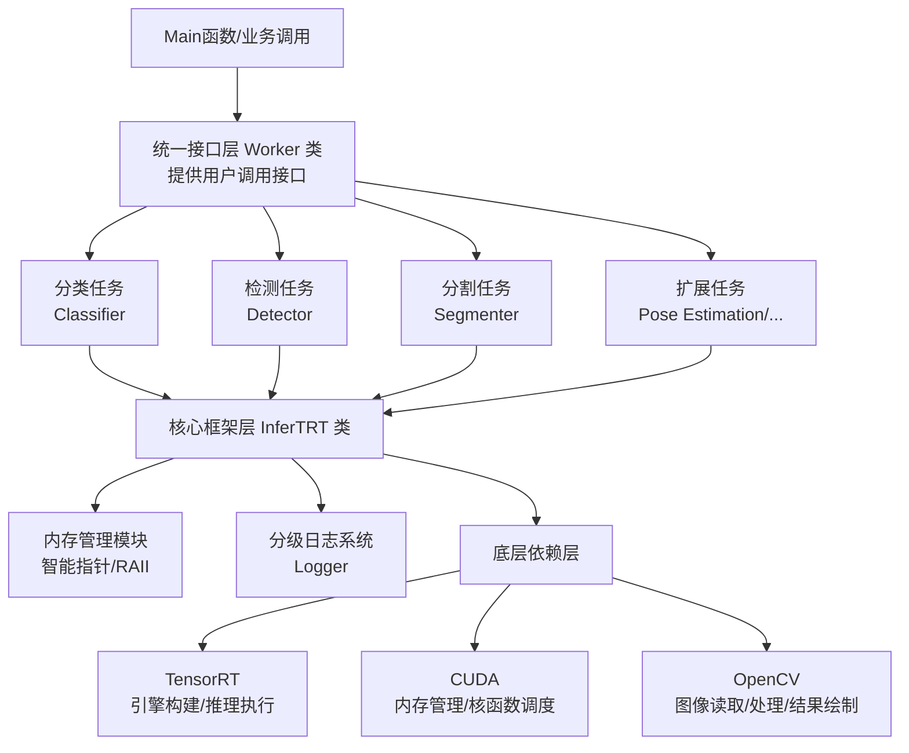


### 继承关系

- **Classifier、Detector、Multitask** 都继承自 **InferTRT**，体现了 "多态" 设计原则

- **Logger** 继承自 TensorRT 的 **ILogger** 接口，实现了自定义的日志功能

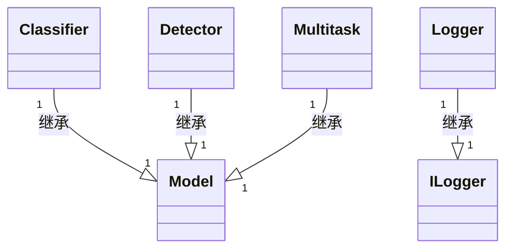


### 组合关系

- **InferTRT** 持有 Params、Logger、Timer 等核心组件，以及 TensorRT 的所有运行时组件

- **Worker** 持有 Logger、Params 以及三种任务处理器（Classifier/Detector/Multitask）

- **Detector 和 Multitask** 都持有多个 bbox 对象

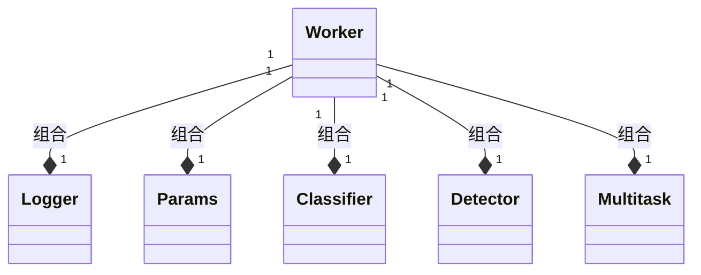

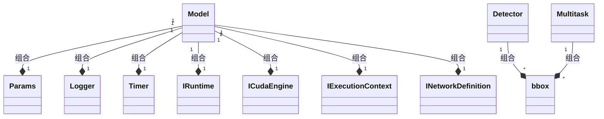


## 模型框架介绍

### 用户调用接口

```c++
// 指定参数：模型文件路径、日志等级、模型构建参数
// 创建 worker
auto p_worker = CreateWorker(str_onnx_path, e_level, c_params);

// 指定待推理图片, 进行推理
p_worker->Inference(str_img_path);
```

### Worker 类，提供外部调用接口

- 作用：保证代码的可读性，只对用户可见必要接口
- 提供接口：
  - 构造函数：根据参数中指定任务类型，构建对应模型
  - 执行推理：读取图像，进行推理

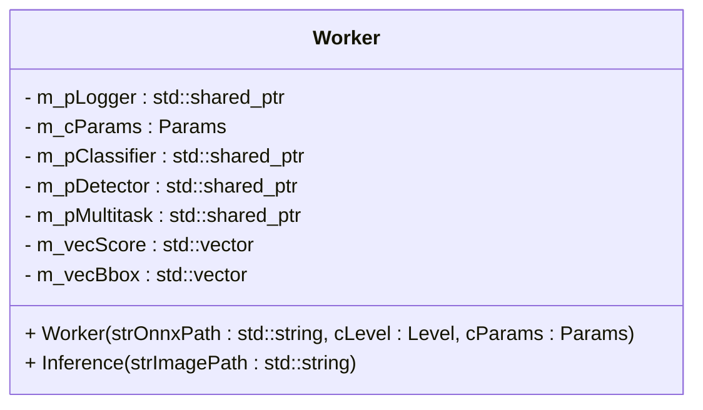

### InferTRT 类，核心框架

- 作用：
  - TensorRT 推理基类，封装 TensorRT 的模型构建和推理流程
  - 提供预处理、后处理接口，具体任务类继承后重写
- 提供接口：
  - 构造函数
  - 图像加载
  - 模型初始化 
    - 加载模型：`.engine` 文件存在则直接加载
    - 构建模型：`.engine` 文件不存在，则从 `.onnx` 文件开始构建
  - 执行推理：
    - 预处理（纯虚函数）
    - 推理
    - 后处理（纯虚函数）
  - 保存模型文件，`.engine` 文件
  - 打印网络结构
  - 获取网络量化精度

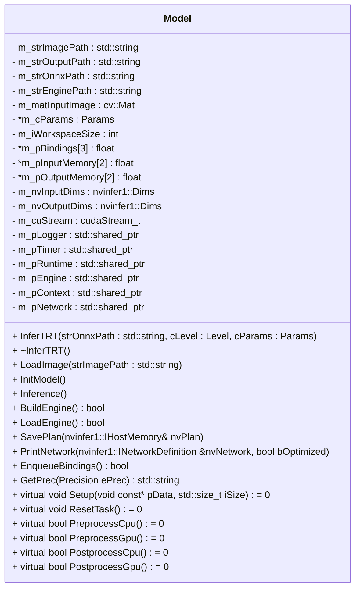

### Classifier 类，继承自 InferTRT，具体分类任务类

- 作用：
  - 继承自 `InferTRT` 推理基类，复用模型构建及推理流程
  - 执行分类任务的预处理/后处理
- 提供接口：
  - 构造函数
  - 设置
  - 任务重置
  - 预处理
  - 后处理

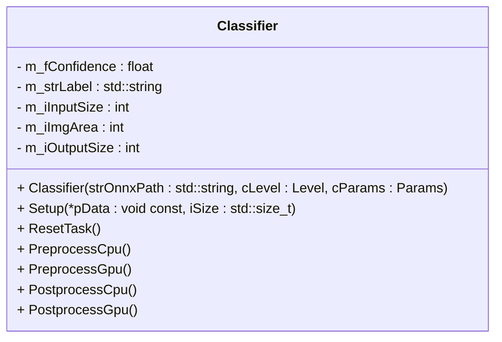

### Detector 类，继承自 InferTRT，具体检测任务类

- 作用：
  - 继承自 `InferTRT` 推理基类，复用模型构建及推理流程
  - 执行检测任务的预处理/后处理
- 提供接口：
  - 构造函数
  - 设置
  - 任务重置
  - 预处理
  - 后处理

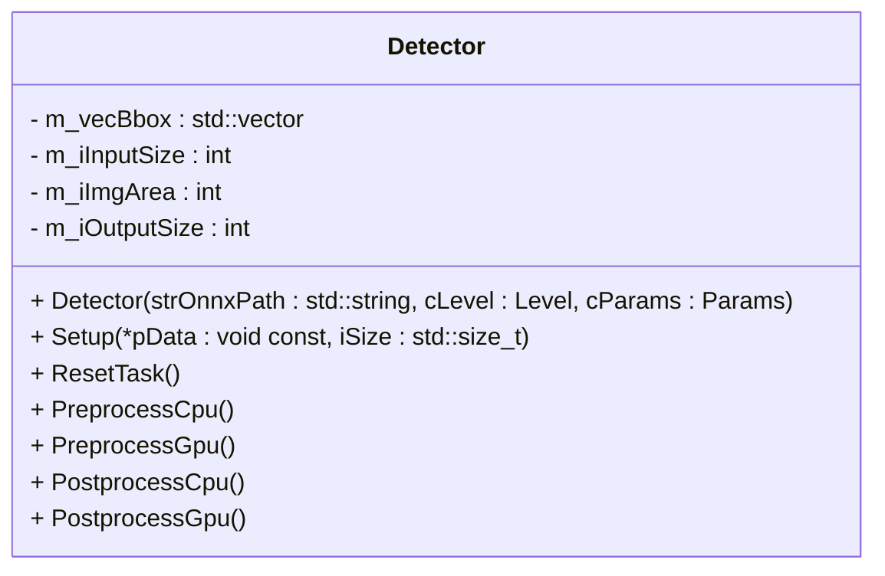

### MultiTask 类，继承自 InferTRT，多任务类

- 作用：
  - 继承自 `InferTRT` 推理基类，复用模型构建及推理流程
  - 执行检测/分割多任务的预处理/后处理
- 提供接口：
  - 构造函数
  - 设置
  - 任务重置
  - 预处理
  - 后处理

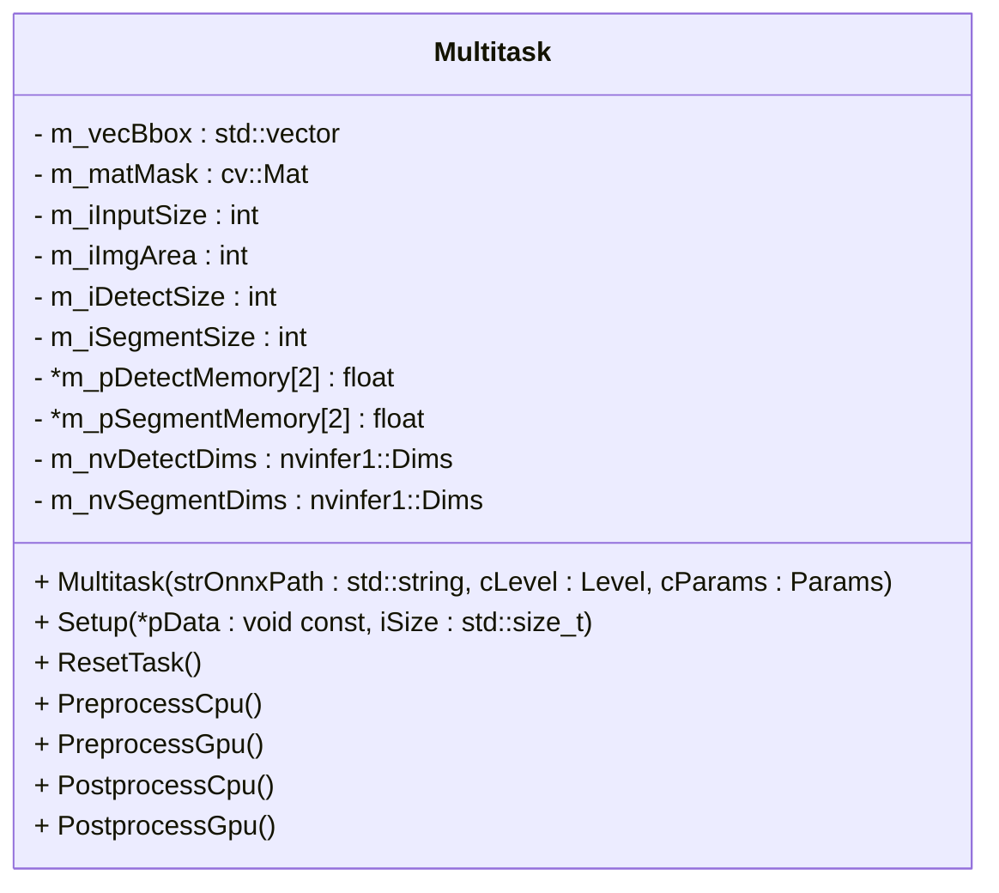

### Logger 类，继承自 `nvinfer1::ILogger`，日志记录

- 作用：
  - 继承 `nvinfer1::ILogger`，重写 `log` 函数
  - 提供分级日志功能，支持 FATAL、ERROR、WARN、INFO、VERB、DEBUG 六个级别，并使用颜色编码来区分不同级别的日志输出
- 提供接口：
  - 构造函数
  - 日志函数，重写 `nvinfer1::ILogger` 的  `log` 函数

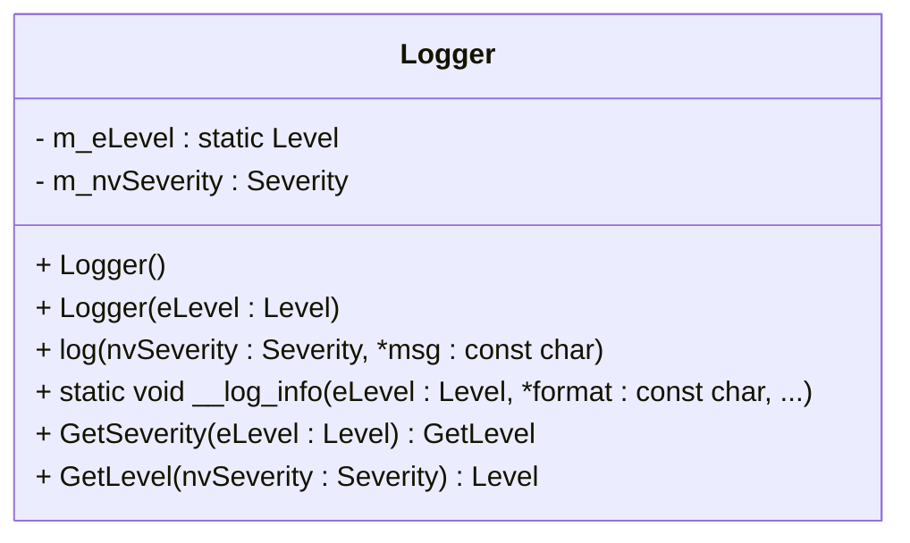

### Timer 类，耗时测量

- 作用：
  - 使用 C++11 的 chrono 库进行 CPU 计时，使用 CUDA 事件进行 GPU 计时
  - 提供 CPU 和 GPU 的精确计时功能，支持纳秒、微秒、毫秒、秒等多种时间单位
- 提供接口：

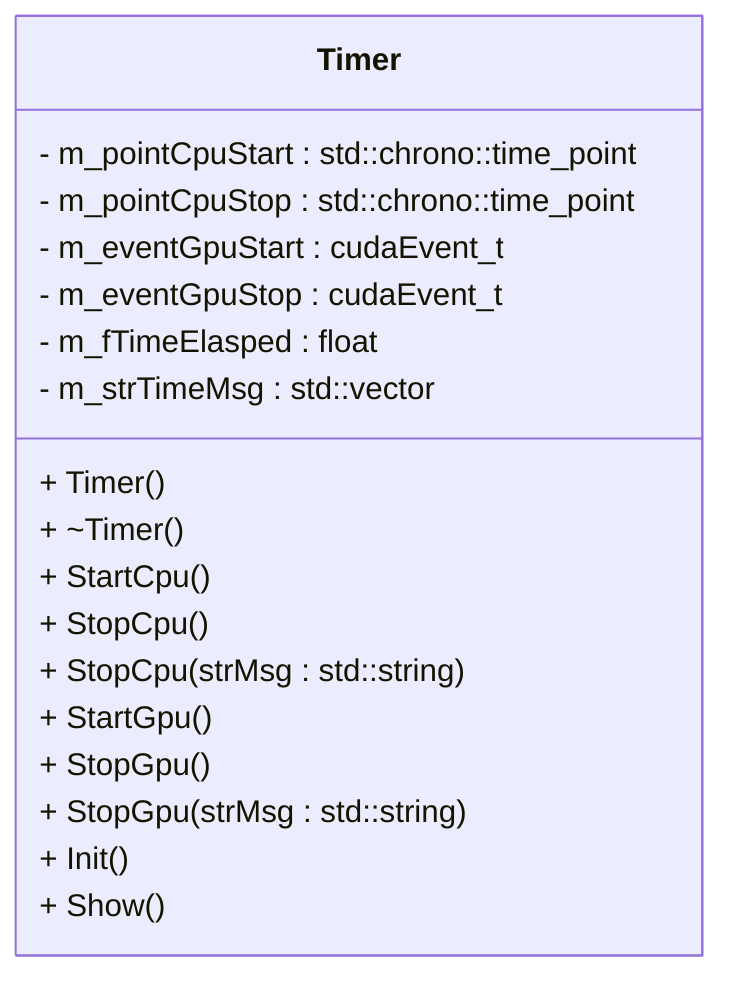

## 数据结构与参数设置

### 任务类别

```c++
enum TaskType {
    CLASSIFICATION,
    DETECTION,
    SEGMENTATION,
    MULTITASK
};
```

### 设备类别

```c++
enum Device {
    CPU,
    GPU
};
```

### 量化精度

```c++
enum Precision {
    FP32,
    FP16,
    INT8
};
```

### 预处理策略

```c++
enum class InterpolationTactics : int32_t {
    CPU_NEAREST         = 0,
    CPU_BILINEAR        = 1,
    GPU_NEAREST         = 2,
    GPU_NEAREST_CENTER  = 3,
    GPU_BILINEAR        = 4,
    GPU_BILINEAR_CENTER = 5,
    GPU_WARP_AFFINE     = 6,
};
```

### 日志级别

```c++
enum class Level : int32_t {
    FATAL = 0,
    ERROR = 1,
    WARN  = 2,
    INFO  = 3,
    VERB  = 4,
    DEBUG = 5
};
```

### 模型构建参数

```c++
struct Params {
    Device               m_eDevice              = GPU;
    int                  m_iNumCls              = 1000;
    InterpolationTactics m_eInterpolationTactic = InterpolationTactics::GPU_BILINEAR;
    ImageInfo            m_cImgInfo             = {224, 224, 3};
    TaskType             m_eTask                = CLASSIFICATION;
    int                  m_iWorkspaceSize       = WORKSPACESIZE;
    Precision            m_ePrec                = FP32;
};
```

## 参考

- 韩君，《CUDA与TensorRT部署实战课程》
