# 3D 肝脏分割部署流程（InferDeploy 框架实操记录）

本文完整记录在 InferDeploy 框架下做 **CT 肝脏 3D 分割** 的落地流程：
**训练/导出 2D UNet → 单切面验证（Dice）→ 体数据逐切面分割（`trt-volume-seg`）→ CUDA 3D 后处理（`liver3d`）→ 体积统计与结果回导 2D/3D**，
并给出每一步的**实测数据、测试图片与分割结果图**。

工程内实际存在两条互补的分割路径，本文以路径 A 为主线（纯框架部署链路），路径 B 作为高精度可选方案（第 8 节）：

| 路径 | 分割模型 | 推理方式 | 后处理 | 适用 |
| --- | --- | --- | --- | --- |
| **A. 2D 切片式**（本文主线） | `liver-unet.onnx`（1.87 M 参数 2D UNet，LiTS 训练） | 逐切面 `UnetSegmenter`（TensorRT / OpenVINO 双后端） | `liver3d`（CUDA 3D CCL + 形态学 + 高斯） | 轻量在线部署、边缘设备、单器官（肝） |
| **B. 3D 基础模型**（第 8 节） | VISTA-3D（NV-Segment-CT，132 类可提示分割） | 3D 整体滑窗（MONAI / ONNX+OpenVINO） | 同一个 `liver3d` | 高精度、全器官、离线批量 |

两条路径**共用同一套 3D 后处理与结果导出链路**，这也是把它们放在一篇文档里的原因。

## 实测环境（本文所有数据均出自此环境）

| 项目 | 值 |
| --- | --- |
| GPU | NVIDIA GeForce RTX 5070 Ti（Blackwell, cc 12.0, 70 SMs） |
| Driver | 595.84 |
| CUDA | 12.4 |
| TensorRT | 10.16（`deps/TensorRT-10.16/usr`） |
| OpenVINO | 2026.3.1（`deps/OpenVINO/usr`，`ENABLE_OPENVINO=1`） |
| OpenCV | 4.x（系统，C++ 侧 `pkg-config opencv4`） |
| Python 侧工具 | `deps/pyenv`（torch 2.14 / onnx 1.21 / onnxruntime 1.24 / nibabel 5.4 / monai 1.6 / matplotlib 3.11） |
| 分割模型 | `data/models/onnx/liver-unet.onnx`（LiTS 真实 CT 自训练） |
| 测试数据 | LiTS 留出切片（带官方 GT）、AMOS demo volume（201 层）、Kaggle liver-ct 序列（36 层）、VISTA-3D 官方 example `spleen_03`（40 层） |
| 采集时间 | 2026-09-17 |

> 图片资源说明：`data/` 被 `.gitignore` 忽略，本文引用的图片是产物的副本，放在 `docs/assets/liver3d/`。
> 全部插图可由 `deps/pyenv/bin/python docs/tools/make_liver3d_figs.py` 一键重生成（前置步骤见第 10 节 A）。

---

## 0. TL;DR：全流程命令

工作目录固定为 `bin/`（框架内所有相对路径以它为基准）。

```bash
# 0) 编译（三个产物：trt-infer / trt-volume-seg / liver3d）
cd /path/to/InferDeploy
make && make volume-seg && make liver3d
cd ./bin

# 1) 单切面分割 + 可视化（第 4 参数 seg = SEGMENTATION 任务）
./trt-infer ../data/models/onnx/liver-unet.onnx \
    ../data/source/ct_liver/lits_v280.tif_z280.png trt seg

# 2) 体数据逐切面分割 + 一键 3D 后处理（TRT FP32，201 层 1.76 s）
./trt-volume-seg ../data/models/onnx/liver-unet.onnx \
    ../data/source/ct_liver/amos_volume ../data/source/result/doc_amos_trt \
    trt --spacing 0.662 0.662 2 --post3d --keep-largest

# 3) 同一份数据换 OpenVINO 后端（CPU），用于跨后端一致性核对
./trt-volume-seg ../data/models/onnx/liver-unet.onnx \
    ../data/source/ct_liver/amos_volume ../data/source/result/doc_amos_ov ov
```

第 2 步的产出（`data/source/result/doc_amos_trt/`）：

```
mask_volume.raw                 3D 二值 mask（uint8，512x512x201，层优先）
summary.txt                     逐层肝区像素数 / 占比
post3d_in/slices/slice_*.u8     3D 后处理输入（0/255 单字节切片）
post3d_in/meta.txt              "W H D dx dy dz"
post3d_out/liver_final.u8       后处理结果（0/1）+ liver_preview_z*.pgm
post3d_out/final_slices/*.png   后处理结果回导的逐层 2D 切面（0/255）
```

---

## 1. 链路总览

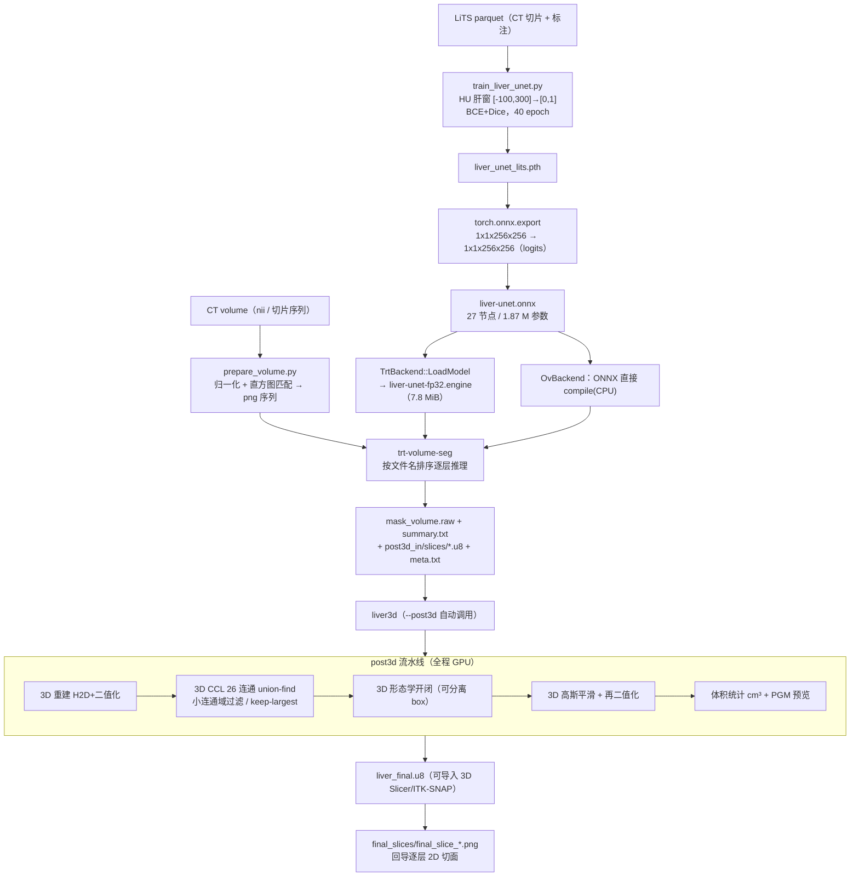

链路上有 **4 个必须成对/必须成立的约定**，破坏任何一条都会出现"流程跑通、结果完全不对"：

| 约定 | 位置 | 破坏后的症状 |
| --- | --- | --- |
| 推理侧 png 的灰度域 == 训练侧（HU 肝窗 `[-100,300]` 线性映射到 0–255） | `train_liver_unet.py` 的 `HU_MIN/HU_MAX` ↔ `UnetSegmenter::Preprocess*` 只做 `/255` | 模型把体壁肌肉/竖脊肌当肝（第 7 节 AMOS 案例即此类） |
| 切片文件名**零填充**且字典序 == 层序 | `samples/volume_seg.cpp` 用 `std::sort` 排序目录内 png | 层序错乱 → 3D 重建出"叠影"，CCL 连通域数暴涨 |
| `meta.txt` 的 `dx dy dz` 必须是真实体素间距 | `--spacing` 写入，`liver3d` 据此算体积 | mask 正确但器官体积成倍偏差（mm³ 统计错） |
| `liver3d` 的输出目录必须已存在 | `volume_seg.cpp` 里 `create_directories`；手工调用需自建 | 后处理直接失败（`liver3d` 不自建目录） |

---

## 2. 第一步：准备分割模型

### 2.1 训练（`data/models/train_liver_unet.py`）

数据用 LiTS 官方挑战数据的 HF 镜像 `krishYK/LiTS-repo`（parquet，切片级 `image`/`label` TIFF，`0=背景 1=肝 2=肿瘤`）。
脚本要点（与部署侧严格对齐）：

| 环节 | 取值 | 与部署侧的关系 |
| --- | --- | --- |
| 强度窗 | HU `[-100, 300]` 截断后线性映射 `[0,1]` | C++ 侧读的是**已按同窗映射到 0–255 的 png**，再 `/255` → 数值域一致 |
| 目标尺寸 | `cv2.resize` 到 256×256（mask 用 `INTER_NEAREST`） | `UnetSegmenter` 输入 `1x1x256x256` |
| 肝标签 | `mask = (label >= 1)`（肝 + 肿瘤合并为前景） | 与部署侧 `logits > 0.5` 二值化后的前景语义一致 |
| 结构 | 3 层 UNet：enc 64/128 → bottleneck 256，`ConvTranspose` 上采样 + 跳连，无 BatchNorm | 导出图 27 节点（Conv 11 / Relu 10 / MaxPool 2 / ConvTranspose 2 / Concat 2） |
| 损失/优化 | `BCEWithLogits + (1 - Dice)`，Adam 1e-3，batch 16，40 epoch | — |
| 数据划分 | 镜像 validation 分片无标注 → 从训练集尾部切 15% 做验证 | 本文的单切面评估用**未参与训练**的留出切片 |

历史训练记录（2026-09-16 采集）：最佳验证集 **Dice 0.969**，权重 `data/models/liver/liver_unet_lits.pth`（7,456,405 B）。
parquet 数据不在仓库内（`data/` 被忽略），故本文不重跑训练，精度以第 4 节的**部署侧实测 Dice** 为准。

### 2.2 导出 ONNX

`data/models/export_liver_unet.py` 用同一份 `LiverUNet` 结构复原权重并导出，随后 `onnx.checker` + `onnxsim.simplify`。

**实测产物 `data/models/onnx/liver-unet.onnx`：**

| 项 | 值 |
| --- | --- |
| 图文件 / 外部权重 | 9,186 B / 7,471,104 B（`liver-unet.onnx.data`，同目录，TRT/OV/ORT 均可读） |
| 参数量 | 1,867,776（FP32） |
| opset / 节点数 | 17 / 27 |
| 输入 | `input` `[batch, 1, 256, 256]`（batch 维动态） |
| 输出 | `output` `[batch, 1, 256, 256]`，**logits**（实测取值范围 −19.7 ~ +10.2） |

> 两个必须知道的事实（相关注释/README 已于 2026-09-17 按此更正）：
> 1. **图里没有 `Sigmoid`**：部署的 ONNX 与 `train_liver_unet.py` 的 `LiverUNet` 一致，`forward` 返回 logits；`export_liver_unet.py` 已改成同样语义（原先它的 `forward` 多包一层 sigmoid，导出的图与部署图不同）。
> 2. 因此 `UnetSegmenter::PostprocessCpu` 的 `threshold(0.5)` 实际是 **logit > 0.5**（≈ sigmoid 0.6225），比"概率 0.5"更严格。第 4.3 节实测这一差异对 Dice 是**正向**的（+1.5 pp）；该语义已写进 `include/tasks/UnetSegmenter.h` 的类注释，**换模型时必须重新确认**。
>
> 历史坑（已修）：`export_liver_unet.py` 的权重默认值曾指向最初打通结构用的 HF 权重 `liver/unet_best.pth`（经 torch 验证输出接近常数，不可部署），现默认 `liver/liver_unet_lits.pth`。

复现导出（脚本已与部署模型对齐，并自带 torch ↔ ONNX 数值自检）：

```bash
cd ../data/models
../../deps/pyenv/bin/python export_liver_unet.py        # 默认 liver_unet_lits.pth -> onnx/liver-unet.onnx
# onnxsim not installed, skip simplify
# max |torch - onnx| = 5.245e-06
```

实测校验：用 `-o` 导出到临时路径后与仓库内 `liver-unet.onnx` 逐元素比对，**最大绝对误差 0**、`logit > 0.5` 的 mask 一致率 **100.0000%**，
节点数/算子集合/输入签名完全一致 → 该脚本可精确复现部署模型。（`onnxsim` 未装于 `deps/pyenv`，已改为可选依赖。）

### 2.3 引擎构建与命名

引擎路径由 `ChangePath(onnxPath, "../engine", ".engine", GetPrec(prec))` 生成：

| ONNX | 请求精度 | engine 文件 | 实测大小 |
| --- | --- | --- | --- |
| `liver-unet.onnx` | FP32（`seg` 任务固定 FP32） | `data/models/engine/liver-unet-fp32.engine` | 8,144,276 B（7.8 MiB） |

引擎已存在时（本文实测情形）日志为 `liver-unet-fp32.engine has been generated! loading trt engine...`，反序列化 6.4 ms，
执行上下文显存 `CPU +0, GPU +72, now: CPU 0, GPU 79 (MiB)`（device scratch 75,761,664 B）。
首次构建则走 ONNX 解析 + 建引擎（远慢于 6.4 ms，且会占 `Params.m_iWorkspaceSize` 的构建期额度），**换模型/换精度后记得删旧 engine**。
OpenVINO 后端不建引擎，直接读 ONNX 并 `compile_model("CPU")`，日志：

```
[info]OpenVINO: reading model ../data/models/onnx/liver-unet.onnx...
[info]OpenVINO: compiling model for device: CPU...
[info]OpenVINO model loaded: 1 input(s), 1 output(s)
[info]liver-unet.onnx model initialized. backend: OpenVINO
```

---

## 3. 第二步：测试数据准备

### 3.1 单切面测试集：LiTS 留出切片（带官方 GT）

`data/source/ct_liver/lits_v280.tif_z280.png` + `..._gt.png`（512×512，png 已按 HU 肝窗映射到 0–255，GT 为 0/255）。
这 4 张切片**未参与训练**（留出集），是本文第 4 节的精度基准。

### 3.2 体数据：nii → png 序列（`data/models/prepare_volume.py`）

```bash
cd ./bin
python ../data/models/prepare_volume.py ../data/source/ct_liver/amos_6346.nii.gz
# -> data/source/ct_liver/amos_volume/amos_z000.png ... amos_z200.png（201 层，512x512）
```

脚本做三件事：`nibabel` 读 volume → 全局 min/max 线性拉伸到 0–255 → **逐层直方图匹配**到 LiTS 参考切片分布（`REF_PNG`，默认 `lits_v280.tif_z280.png`）。
直方图匹配是跨中心/跨标准化方案的常规适配手段，但**它只能对齐灰度分布，不能补齐语义域差异**（第 7 节会看到它的局限）。

AMOS demo volume（`amos_6346.nii.gz`，512×512×201，spacing 0.662/0.662/2.0 mm）测试切片：

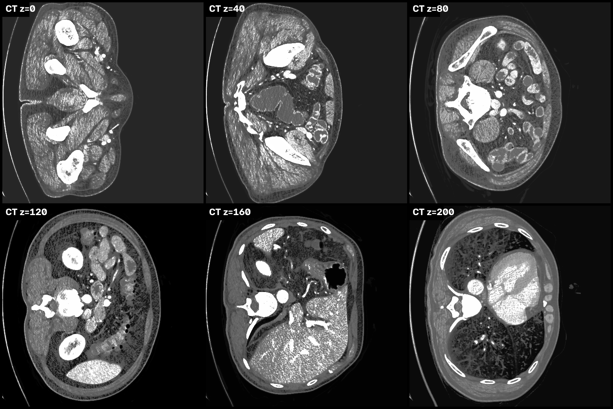

> 层序方向：z 从足侧向头侧递增——z=000 在大腿根/盆腔下缘，z≈140~185 才是肝所在的上腹层面，z=200 已进入胸腔（心影 + 肺）。
> 第 5/6 节结果图里 z 偏大的层都是胸部层面，而**假阳性恰好集中在这些层**（z=194 单层 43,104 px = 16.44%）。

### 3.3 序列化分类数据集重组为体数据（Kaggle `liver-ct-image-dataset`）

该数据集是**脂肪肝二分类集**（3557 张 256×256 jpg，实测目录内 `Healthy/` + `Hepatic_Steatosis/` 两类），但文件名
`<序列号>-img-<层号>-<帧号>.jpg` 保留了层序，同一序列号可重组为体数据（本文用的序列 128 属 `Healthy` 类，有 36 个连续层）。
匿名下载端点：`https://www.kaggle.com/api/v1/datasets/download/<owner>/<slug>`。

重组 + 域适配（按 seq 分组 → 层号排序 → 直方图匹配到 LiTS 参考 → 零填充命名）：

```python
# 关键约定：输出文件名必须零填充，volume_seg 按字典序 == 层序
files = sorted(glob.glob(f"{root}/{seq}-img-*.jpg"), key=lambda p: int(p.split("-img-")[1].split("-")[0]))
for z, p in enumerate(files):
    img = cv2.imread(p, cv2.IMREAD_GRAYSCALE)
    cv2.imwrite(f"kaggle_seq128/kaggle_z{z:03d}.png", match_histogram(img, lits_ref))
```

---

## 4. 第三步：单切面分割与精度验证

### 4.1 命令与日志

```bash
cd ./bin
./trt-infer ../data/models/onnx/liver-unet.onnx \
    ../data/source/ct_liver/lits_v280.tif_z280.png trt seg
```

`seg` 开关把任务切成 `SEGMENTATION`（`Params.m_eTask`），并固定 `m_eDevice = CPU`、`m_ePrec = FP32`。实测日志：

```
[info]../data/models/onnx/../engine/liver-unet-fp32.engine has been generated! loading trt engine...
[info]Loaded engine size: 7 MiB
[info][MemUsageChange] ... CPU +0, GPU +72, now: CPU 0, GPU 79 (MiB)
[info]liver-unet.onnx model initialized. backend: TensorRT
[info]*********************INFERENCE INFORMATION***********************
[info]  Model:      liver-unet.onnx
[info]  Image:      lits_v280.tif_z280.png
[info]  Precision:  fp32
[info]  Result:
[info]          Liver mask: 5362 pixels (8.18% of slice)
[info]  save result to .../data/source/result/lits_v280.tif_z280-liver-fp32.png
[info]  save mask  to .../data/source/result/lits_v280.tif_z280-liver-fp32-mask.png
```

> `Liver mask: 5362 pixels` 是**网络分辨率 256×256** 上的像素数（8.18% = 5362/65536）；
> 落盘的 `-mask.png` 已上采样回原图 512×512，故前景数为 21,448（= 5362×4，线性插值 + `>127` 后完全一致）。
> 另：`Liver mask` 之后的三行 `[verb]` 就是逐阶段耗时（日志级别 ≥ VERB 可见，`trt-infer` 默认的 DEBUG 即可）：
> `preprocess(CPU) 0.102 ms` / `trt-inference(GPU) 1.664 ms` / `postprocess(CPU) 3.888 ms`（含两张 png 的 `imwrite`）。
> 体数据批量模式（`SetSaveDebug(false)`）**不**打印逐层耗时，避免刷屏。

### 4.2 部署侧 Dice 实测（C++ 输出 vs LiTS 官方 GT）

| 切片 | 前景 px（512²） | GT px | **Dice（TRT FP32 部署链路）** | Dice（ONNXRuntime 参考实现） |
| --- | --- | --- | --- | --- |
| `lits_v280.tif_z280` | 21,448 | 18,490 | **0.9163** | 0.9179 |
| `lits_v281.tif_z281` | 22,444 | 19,177 | **0.9138** | 0.9159 |
| `lits_v282.tif_z282` | 23,804 | 20,054 | **0.9088** | 0.9110 |
| `lits_v283.tif_z283` | 24,224 | 21,047 | **0.9224** | 0.9244 |
| 均值 | — | — | **0.9153** | 0.9173 |

两条独立实现（C++/TRT 引擎 vs Python/ONNXRuntime CPU）的**逐像素一致率 99.80%~99.83%**，
Dice 差 ≤ 0.002。差异全部落在边界：C++ 是"256² 输出先阈值二值化 → 上采样 → `>127`"，Python 参考是"256² 输出先上采样 → 再阈值"，
两者只在 mask 轮廓的 1~2 px 带宽内不同。**结论：部署链路没有引入实现误差，模型上限就是 0.91 量级（2D 单切面、无 3D 上下文）。**

| 输入 CT | LiTS GT | 框架结果（红色叠加，Dice 0.916） |
| --- | --- | --- |
| 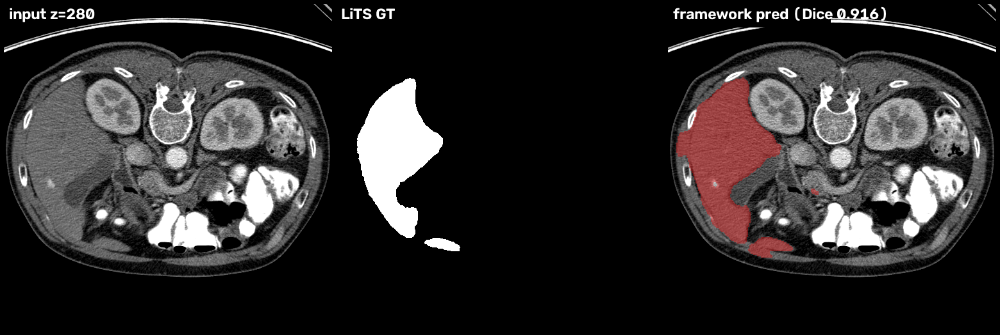 | | |
| 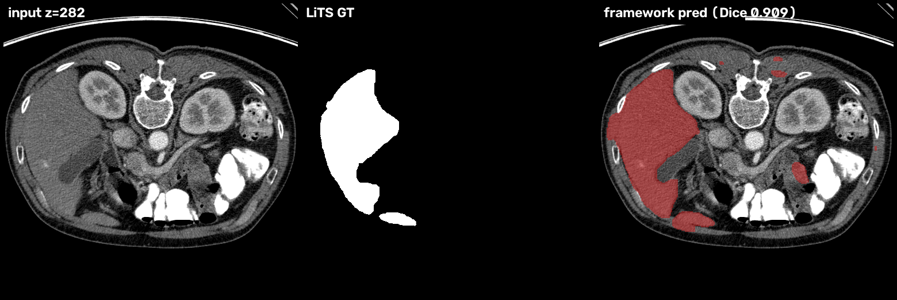 | | |

### 4.3 阈值语义的实测影响（logit 图上的 0.5）

| 阈值口径 | z280 | z281 | z282 | z283 | 说明 |
| --- | --- | --- | --- | --- | --- |
| `logit > 0.5`（框架现状） | 0.9163 | 0.9138 | 0.9088 | 0.9224 | 前景 5,362 / 5,611 / 5,951 / 6,056 px（256²） |
| `logit > 0`（= 概率 0.5） | 0.9048 | 0.8961 | 0.8897 | 0.9032 | 前景多 3.8%~5.7%，过分割加重 |

当前模型在留出集上**略微过分割**，因此偏严的 `logit > 0.5` 反而多拿 ~1.5 pp Dice。
这是"歪打正着"，不是设计：**换模型后必须重新核对输出是 logits 还是概率**，否则阈值含义会静默漂移。

---

## 5. 第四步：体数据逐切面分割（`trt-volume-seg`）

### 5.1 命令行与参数

```
./bin/trt-volume-seg <onnx_path> <input_slice_dir> <output_dir> [trt|ov] \
                     [--spacing dx dy dz] [--post3d [liver3d 额外参数...]]
```

| 参数 | 说明 |
| --- | --- |
| `[trt\|ov]` | 推理后端；`ov` 需 `ENABLE_OPENVINO=1` 编译 |
| `--spacing dx dy dz` | 体素间距（mm），写入 `post3d_in/meta.txt`，只影响 `liver3d` 的 cm³/L 统计 |
| `--post3d` | 分割完成后自动调用 `bin/liver3d`；其后以 `-` 开头的参数原样透传（如 `--keep-largest --minsize 128 --mrz 2`） |

工具内部固定 `m_eTask = SEGMENTATION`、`m_eDevice = CPU`、`m_ePrec = FP32`，并调用 `p_seg->SetSaveDebug(false)`
关闭逐层结果图落盘，改为统一写 3D 产物（`GetMask()` 取 0/255 mask 后累积）。
`liver3d` 二进制按 `./liver3d → bin/liver3d → ../bin/liver3d → post3d/bin/liver3d` 顺序探测，故从 `bin/` 运行最省事。

### 5.2 产物结构（实测，AMOS 201 层）

```
doc_amos_trt/
├── mask_volume.raw            52,690,944 B = 512x512x201，uint8 0/255，层优先（z 外层）
├── summary.txt                表头 slice\tliver_pixels\tliver_ratio(%)，末尾追加 "volume: 512 x 512 x 201"
├── post3d_in/
│   ├── meta.txt               "512 512 201 0.662 0.662 2"
│   └── slices/slice_0000.u8 … slice_0200.u8   各 262,144 B（0/255）
└── post3d_out/                （--post3d 时生成，见第 6 节）
```

> 2D 可视化只有第 6.3 节的 `final_slices/`（需 `--post3d`）；`samples/volume_seg.cpp` 的头部注释已按实际产物更新，
> 不再声称输出逐层 `mask_<name>.png`。

### 5.3 实测耗时

| 场景 | 配置 | 端到端墙钟 | 折算单切面 |
| --- | --- | --- | --- |
| AMOS 201 层（512×512） | TRT FP32，不含 `--post3d` | **1.289 s** | ≈ 6.4 ms/层 |
| AMOS 201 层 | TRT FP32 + `--post3d --keep-largest` | **1.761 s**（其中后处理 73 ms） | — |
| AMOS 201 层 | OpenVINO 2026.3.1 **CPU** | **10.979 s** | ≈ 54.6 ms/层 |
| Kaggle seq128 36 层（256×256） | TRT FP32 + `--post3d --keep-largest` | **0.694 s**（后处理 5.7 ms） | ≈ 19 ms/层（含引擎加载） |

上表计时含一次性开销（引擎反序列化 6.4 ms + 逐层 `imread`/`resize`/D2H），**未含** `TrtBackend` 首次建引擎。
单切面的逐阶段实测（第 4.1 节的 `Timer` 输出）：`preprocess(CPU)` 0.10 ms、`trt-inference(GPU)` 1.66 ms、`postprocess(CPU)` 3.89 ms（含两张 png 落盘）。
体数据模式关掉落盘后逐层墙钟 ≈ 6.4 ms，主要成本在 D2H + `mask_volume.raw`/`slice_*.u8` 写盘与 `imread`；
CPU 预处理是 `cv::resize` + 逐像素 `/255` 循环（`UnetSegmenter::PreprocessCpu`），若换 GPU 预处理路径（`ResizeGrayGpu`）需把 `m_eDevice` 改为 `GPU`。

> 提醒：反序列化是一次性开销（6.4 ms），与"6.4 ms/层"数值巧合，两者无关。

### 5.4 双后端一致性（同一模型、同一数据）

| 指标 | TRT FP32（GPU） | OpenVINO FP32（CPU） |
| --- | --- | --- |
| 前景体素总数 | 2,750,052 | 2,749,340 |
| 逐体素差异 | — | **5,204 / 52,690,944 = 0.0099%**（一致率 99.9901%） |

差异全部落在阈值边界（logit ≈ 0.5）附近的体素上（两套实现各自的浮点累加顺序不同），
`--post3d` 之后（keep-largest）两后端结果在器官尺度上不可区分。**结论：换后端不需要重训/重调阈值。**

### 5.5 逐层面积统计

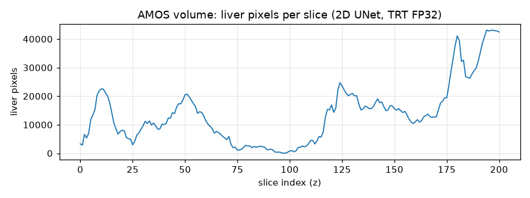

| 统计量 | AMOS（201 层） | Kaggle seq128（36 层） |
| --- | --- | --- |
| 有检出的层数 | **201 / 201（100%）** | 36 / 36 |
| 单层最大前景 | 43,104 px（z=194，16.44%） | 1,201 px |
| 全部层前景合计 | 2,750,052 px | 24,040 px |

**"每层都有肝"本身就是假阳性信号**：真实腹部 CT 的肝只占据约 30~40% 的层面。
逐层曲线（`summary.txt`）是最低成本的质检手段：本例在 **z ≥ 180 突然抬升到 3.2万~4.3万 px（12%~16.4%）**，
而那里已经是胸腔层面（心影 + 肺），**根本没有肝**。这种"前景面积跟着躯干外轮廓走"的曲线就是肌肉误报的指纹。

原始逐层 mask（与 3.2 的 CT 切面同层位）：

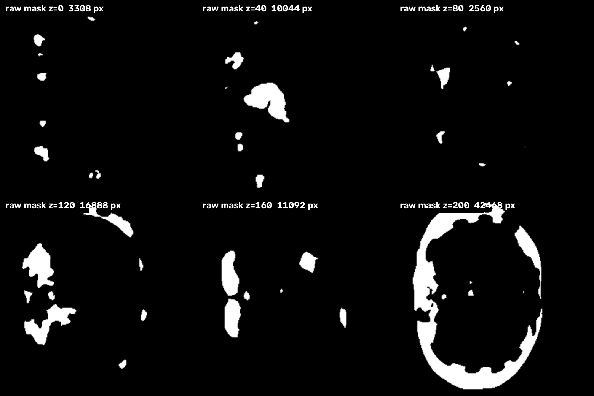

### 5.6 业务侧接入（不用 CLI 时）

```cpp
Params c_params;
c_params.m_eTask    = SEGMENTATION;      // Worker -> UnetSegmenter
c_params.m_eBackend = TENSORRT;          // 或 OPENVINO
c_params.m_eDevice  = CPU;               // 灰度预处理路径
c_params.m_ePrec    = FP32;

auto p_worker = CreateWorker("../data/models/onnx/liver-unet.onnx", Level::INFO, c_params);
auto* p_seg   = p_worker->m_pUnetSegmenter.get();
p_seg->SetSaveDebug(false);              // 批量体数据：不落盘，自己收 3D 数组

for (const auto& str_slice : vec_slices) {   // 文件名排序 == 层序
    p_worker->Inference(str_slice);          // 引擎与缓冲只初始化一次，逐层复用
    const cv::Mat& c_mask = p_seg->GetMask();// 0/255，原图尺寸
    vec_volume.insert(vec_volume.end(), c_mask.data, c_mask.data + c_mask.total());
}
```

要点：`Worker::Inference` 每次一层，`InitModel()` 第二次起只 `ResetTask()`，因此批量跑不需要重建上下文；
`GetMask()` 返回的 `cv::Mat` 在下一层推理时会被 `release()` 覆盖，需及时拷贝。

---

## 6. 第五步：CUDA 3D 后处理（`post3d/liver3d`）

### 6.1 流水线与关键参数

`slice_*.u8 + meta.txt` → ① 3D 重建（H2D + 二值化）→ ② 3D CCL（26 连通并行并查集，`atomicMin` 合并根）+ 小连通域过滤 →
③ 3D 形态学闭→开（可分离 box，X/Y/Z 三次 1D min/max，O(r)/体素）→ ④ 3D 可分离高斯 + 再二值化 → ⑤ D2H + 体积统计 + PGM 预览。

| 参数 | 默认 | 用途/调参经验 |
| --- | --- | --- |
| `--minsize <int>` | 64 | 小于该体素数的连通域清零；层状假阳性多时优先加大 |
| `--keep-largest` | off | 只留最大连通域。单器官（肝）场景推荐；本例把 240 个域压到 1 个 |
| `--mrx/--mry/--mrz <int>` | 1 1 1 | 形态学半径。**层厚远大于层内分辨率时（如 dz=2 mm）加大 `--mrz` 才能弥合层间断裂** |
| `--no-open` / `--no-close` | off | 关闭开/闭运算。真实器官边界毛刺多时保留开运算 |
| `--sigma` / `--gthr` | 1.0 / 0.5 | 高斯平滑强度与再二值化阈值；`sigma` 过大会吃掉细小突起（如尾状叶） |
| `--bin <int>` | 0 | 输入按 `raw > bin` 二值化；喂概率图时需改（如 127） |
| `--no-gt` | – | 无标注时必须加，否则默认去找 `data/liver_gt.u8` |

算法细节与 CUDA 实现见 [post3d/docs/ALGORITHM.zh-CN.md](../post3d/docs/ALGORITHM.zh-CN.md)、
[post3d/docs/CUDA_GUIDE.zh-CN.md](../post3d/docs/CUDA_GUIDE.zh-CN.md)。

### 6.2 实测（AMOS 201 层，52.69 M 体素）

`--post3d --keep-largest` 自动调用，`liver3d` 自报（GPU 阶段各 5 次取均值）：

```
 GPU            : NVIDIA GeForce RTX 5070 Ti (70 SMs, cc 12.0)
 Volume         : 512 x 512 x 201  (52.69 M voxels)
 Voxel spacing  : 0.662 x 0.662 x 2.000 mm
   1a. reconstruct 3D (load slices)           6.516 ms
   1b. reconstruct 3D (H2D+binarize)          6.127 ms
   2.  3D CCL + component filter              5.531 ms
   3.  3D morphology (close+open)             6.577 ms
   4.  3D Gaussian smooth + threshold         4.263 ms
   5. finalize (D2H+stats+write)             43.973 ms
   TOTAL pipeline                            72.987 ms
 CCL: components found=240 kept=1 largest=1504692 voxels (iters=2)
      foreground  before filter=2750052  after filter=1504692
 Foreground voxels: reconstructed=2750052  final=1506108
 Organ volume     : 1320085.6 mm^3 = 1320.086 cm^3 = 1.3201 L
```

| 观察 | 数值 | 解读 |
| --- | --- | --- |
| CCL 发现连通域 | **240 个** | 逐层 2D 推理的必然结果：每层的独立假阳性都成为一个跨层短域 |
| keep-largest 后 | 2,750,052 → 1,504,692 体素（**−45.3%**） | 一半以上的"肝"是碎片，被 3D 连通性判掉 |
| 形态学 + 高斯后 final | 1,506,108 体素 | 闭运算补回的层间断裂略多于开运算/高斯削掉的毛刺 |
| 纯 GPU 计算（1b–4） | 22.5 ms | 端到端 73 ms 里约 **69%** 是文件 I/O（1a 读 201 个 u8 6.5 ms + 5 写 52 MB 结果 44.0 ms） |

> 计时口径：上表是单次运行的 `liver3d` 自报值（GPU 阶段各 5 次取均值）。1b–4 的 GPU 部分跨运行稳定，
> 而 1a/5 两个 I/O 阶段受磁盘缓存影响较大（同一条命令复跑实测 TOTAL 在 73~86 ms 浮动），**不要把 TOTAL 当硬指标**。

后处理输出的轴位 PGM 预览（z=000/100/200）：

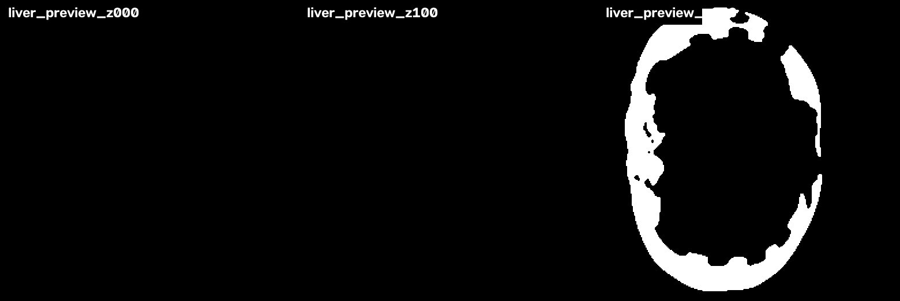

**后处理前后对比（左：逐层原始 mask；中：`liver_final.u8`；右：CT + 后处理叠加）**：

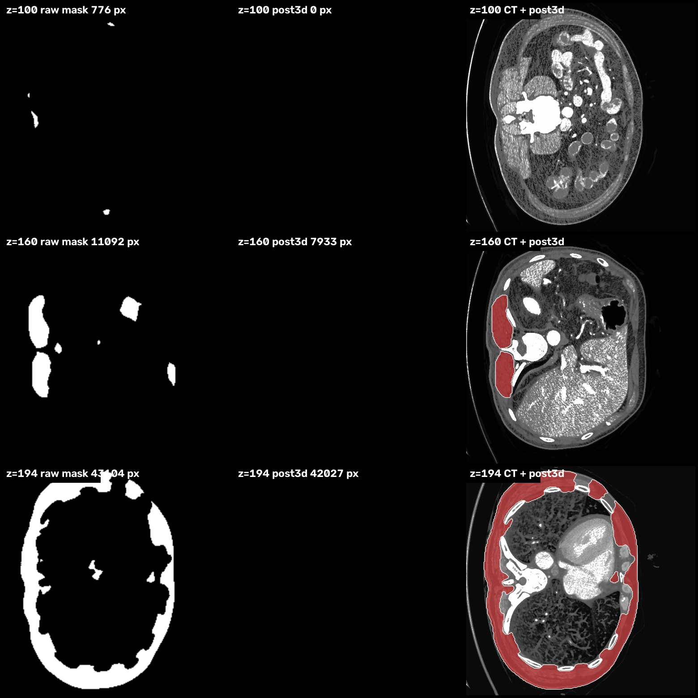

### 6.3 后处理结果回导 2D 切面

`--post3d` 完成后，`volume_seg.cpp` 自动把 `liver_final.u8` 按层切回 png（0/255）：

```
Final mask exported as 2D slices: .../post3d_out/final_slices/final_slice_*.png (201 slices)
```

命名 `final_slice_%04d.png`，与输入切片序号一一对应，可直接喂给 2D 标注工具或做逐层 Dice 评估。

### 6.4 3D 可视化 / 导入 3D Slicer

`liver_final.u8` 是裸 uint8（0/1），两种用法：

```bash
# 1) 3D Slicer / ITK-SNAP：File -> Add Data -> 选 .u8，
#    手工填 Image size = 512 512 201，Element size = 0.662 0.662 2.0，Bytes per element = 1
```

```python
# 2) 转 nii.gz（携带 spacing）
import numpy as np, nibabel as nib
W, H, D, dx, dy, dz = 512, 512, 201, 0.662, 0.662, 2.0
vol = np.fromfile("post3d_out/liver_final.u8", np.uint8).reshape(D, H, W).transpose(1, 2, 0)
nib.save(nib.Nifti1Image(vol, np.diag([dx, dy, dz, 1])), "liver_final.nii.gz")
```

> 仓库内已有的 `data/source/result/amos_volume/liver_mask_3d.nii.gz` 是**后处理前**的逐层 mask 体
> （512×512×201 uint8，前景 2,750,052 体素，与 `mask_volume.raw` 前景数完全一致，可当作本段代码的对照产物；
> 但它的 affine 是 1 mm 等方的 identity，拿它直接读体积会得到 mm³ 口径的错值，需要真实 cm³ 时按上面的 `dx dy dz` 重建）。

> `mask_volume.raw` / `liver_final.u8` 的轴序都是**层优先**（`[D][H][W]`，z 在最外层），
> 与 `post3d_in/slices/slice_%04d.u8` 的逐层写入顺序一致；转 nii 时需要 `transpose(1,2,0)`。

---

## 7. 结果解读：跨域与失效模式（重要教训）

本文刻意保留了两个**失败/半失败案例**，因为它们比成功案例更能说明链路哪里会出问题。

### 7.1 AMOS demo volume：数值域不匹配 → 语义错误

第 6.2 节那份"1.32 L 的肝"其实是**腹壁肌肉 + 竖脊肌被误判**（见 6.2 结果图 z=194 的环形区域）。根因：

1. `amos_6346.nii.gz` 的数值域是标准化浮点（约 −2.7~3.3），**不是 HU**，且 nii 头 `scl_slope = nan`（元数据损坏）；
2. `prepare_volume.py` 的直方图匹配只能对齐灰度**分布形状**，无法恢复 HU 语义；
3. 肌肉与肝实质在肝窗下灰度本就接近 —— 2D 模型没有 3D 上下文、也没有位置先验，只能按灰度猜。

**`liver3d` 的表现完全符合其定位**：240 个碎片清成 1 个域、体积从 2.41 L（2,750,052 体素 × 0.876 mm³）降到 1.32 L，
但**它无法纠正语义错误**——最大的那个连通域本身就是错的。判定：3D 后处理是"形状约束"，不是"语义约束"。

> 交叉验证：同一条 AMOS demo volume 交给 VISTA-3D（官方 bundle、torch/GPU）也只给出 **124,788 体素 = 109.4 cm³**
> （`backup/post3d_extra/NV-Segment-CT/eval/amos_6346/amos_6346_trans.nii.gz` 实测），远低于正常肝体积。
> 两个完全不同的模型在同一份数据上双双失效 → 根因在**数据**，不在模型或框架。

### 7.2 Kaggle seq128：跨中心 + 预处理差异 → 肝实质检出失败

```
Volume : 256 x 256 x 36   CCL: components found=70 kept=1 largest=8748
foreground before filter=24040  final=8103  Organ volume = 8.103 cm^3   (TRT 端到端 0.694 s)
```

36 层里每层只有几百像素被标出，且都落在**器官轮廓之外的高亮边缘**（肋骨皮质/脂肪界面）；
最终"肝"只有 8.1 cm³（正常成人肝 1000~1500 cm³，差两个数量级）。这是典型的"检出了像肝的东西，但不是肝"。
该数据集本身是**脂肪肝二分类集**（jpg、有压缩、窗宽未知），LiTS 模型在此必须微调才可用。

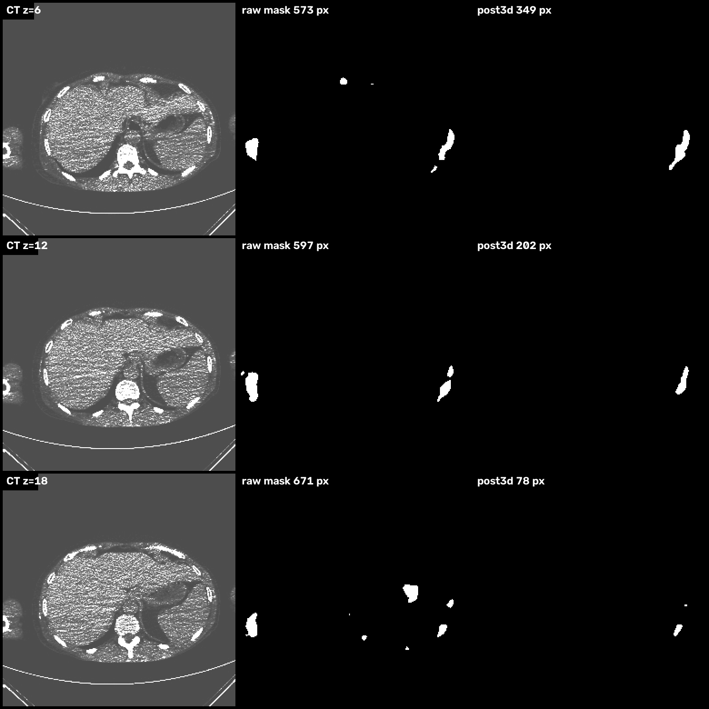

### 7.3 三条可复用的判据

| 判据 | 看什么 | 结论 |
| --- | --- | --- |
| 逐层检出率 | `summary.txt` 里"有前景的层数 / 总层数" | 100% 基本就是假阳性（肝只占腹部 CT 的 30~40% 层面） |
| 体积合理性 | `liver3d` 的 cm³/L | 成人肝 1.0~1.8 L；<0.1 L 或 >2.5 L 先怀疑域不匹配，而不是先怀疑阈值 |
| 连通域数 | `CCL: components found` | 几十~几百 = 逐层噪声主导（2D 模型跨域的典型指纹）；个位数 = 域基本对 |

**同域数据才可靠**：LiTS 训练 + LiTS 留出切片验证 = Dice 0.915（第 4 节）；换成非 HU 的 AMOS demo = 语义错误。
需要跨中心可靠工作，走第 8 节的 3D 基础模型，或用目标域数据微调。

---

## 8. 可选路径：VISTA-3D（3D 基础模型）+ 同一后处理链路

> 该路径的脚本与 bundle 目前归档在 `backup/`（`backup/vista3d_deploy.py`、`backup/post3d_extra/NV-Segment-CT/`），
> 不随主工程构建；产物保留在 `data/source/result/spleen_03.nii_vista3d/`（ONNX+OpenVINO 部署链路）、
> `data/source/result/spleen03_post3d/`（MONAI bundle 基准）。本节数据由**保留产物 + 重跑 `liver3d`** 复算得到。

VISTA-3D（`NV-Segment-CT` MONAI bundle）是 132 类腹盆器官/肿瘤的可提示 3D 分割基础模型（`label_dict.json`：liver=1、hepatic tumor=26），
直接吃完整 nii，滑窗推理（roi 128³、overlap 0.3）。工程化部署已脱离 torch：

| 环节 | 实现 |
| --- | --- |
| 导出 ONNX | `data/models/export_vista3d_liver.py`：`monai.networks.nets.vista3d132` + `model.pt`，把 `class_vector=[[1]]`（**Long 型肝索引，不是 onehot**）烘焙进图 → 单输入 `[B,1,128,128,128]`；786 MB 权重落外部 `vista3d_liver.onnx.data` |
| 推理 | `backup/vista3d_deploy.py`：bundle 同款预处理（RAS、1.5 mm 重采样、强度窗 `[-963.8,1053.7]→[0,1]`）+ `sliding_window_inference`，网络前向交给 **OpenVINO CPU** 的 ONNX session |
| 逆变换 | `Invertd` 回原始空间，`logits > 0` 二值化，用**原图 affine** 存 `liver_mask.nii.gz`（保证与世界坐标配准） |
| 后处理 | 写 `post3d_in/slices/*.u8 + meta.txt`（spacing 从 nii header `get_zooms()` 读）→ 调 `bin/liver3d --keep-largest` → 导出 `final_slices/` |

实测（官方 example `spleen_03.nii.gz`，512×512×40，spacing 0.7383/0.7383/5.0 mm，prompt = liver）：

```
 Volume : 512 x 512 x 40 (10.49 M voxels)     分割前景 = 456,816 体素（1245.0 cm^3）
 CCL: components found=1 kept=1 largest=456816 (iters=2)      ← 无碎片
 final = 454,727 体素    Organ volume = 1239.329 cm^3 = 1.2393 L
 liver3d TOTAL pipeline = 22.829 ms（1a 1.471 / 1b 0.992 / 2 1.143 / 3 0.926 / 4 0.959 / 5 17.337）
```

**部署链路（ONNX + OpenVINO CPU）与官方 bundle（torch）的一致性**（同一 `spleen_03.nii.gz`、同一 prompt、同一后处理参数）：

| 阶段 | MONAI bundle（torch） | 部署链路（OV CPU） | 差异 |
| --- | --- | --- | --- |
| 分割前景体素 | 456,966（1245.4 cm³） | 456,816（1245.0 cm³） | **0.033%** |
| `liver3d` 后处理前景 | 454,811（1239.5 cm³） | 454,727（1239.3 cm³） | **0.019%** |

即：把 3D 基础模型换成工程侧的 ONNX 部署，**体积统计口径上完全等价**（差异在滑窗边界的浮点误差量级）。

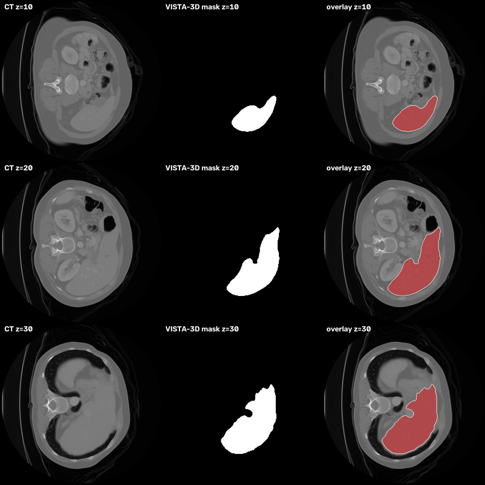

后处理 PGM 预览（单一规整器官轮廓，与 7.1 的 AMOS 环形假阳性形成直接对比）：

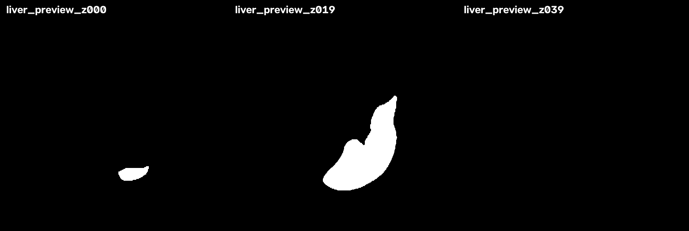

### 8.1 两条路径横向对比

| 维度 | 路径 A：2D UNet + post3d | 路径 B：VISTA-3D + post3d |
| --- | --- | --- |
| 模型体积 | ONNX 7.5 MB / engine **7.8 MB** | `model.pt` 872 MB / ONNX 权重 786 MB |
| 单例耗时 | 201 层 **1.3 s**（TRT GPU）+ 73 ms 后处理 | 后处理 22.8 ms（40 层）；滑窗推理耗时本文**未实测**（GPU torch 为数秒量级，OV CPU 视 volume 尺寸上升） |
| 输入 | 逐层 png（需自做窗宽/域适配） | 完整 nii（自带 RAS + 重采样 + 强度窗） |
| **同域数据表现** | LiTS 留出切片 Dice **0.915**（第 4 节） | spleen_03：1 个连通域、1239.3 cm³（正常成人肝范围） |
| **同一跨域数据（AMOS demo）** | 240 个连通域、1320 cm³（**肌肉误报**，不可信） | 仅 109.4 cm³（几乎检不到肝，同样不可信） |
| 失效模式 | 按灰度猜 → **假阳性**（多分） | 依赖强度窗语义 → 域不对时**漏分**（少分） |
| 框架耦合 | 纯 `InferBase`/`TrtBackend`/`OvBackend` 部署链路 | torch/MONAI 预处理 + **ONNX 走 OpenVINO**，后处理共用 `liver3d` |
| 选型 | 单器官、边缘/在线、延迟敏感 | 多器官、离线批量、要求鲁棒 |

**共同结论**：3D 后处理（`liver3d`）在两条路径里表现一致——它稳定地把 mask 规整化并给出体积，
但结果质量的上限始终由分割模型是否工作在**其训练域**决定。

---

## 9. 产物清单与资源占用（实测）

| 产物 | 大小 | 说明 |
| --- | --- | --- |
| `liver-unet.onnx`（+ `.data`） | 9,186 + 7,471,104 B | 1.87 M 参数，opset 17，27 节点 |
| `liver-unet-fp32.engine` | 8,144,276 B | 构建一次即复用；改精度/换模型需删旧文件 |
| 执行上下文显存 | GPU +72 MiB | device scratch 75,761,664 B（TRT 构建日志） |
| `mask_volume.raw`（512×512×201） | 52,690,944 B | uint8 0/255，层优先 |
| `post3d_in/slices/*.u8` | 201 × 262,144 B | 与 raw 内容重复（后处理输入格式） |
| `post3d_out/liver_final.u8` | 52,690,944 B | uint8 **0/1**（不是 0/255，做 Dice 前需 ×255 或改比较） |
| `post3d_out/final_slices/*.png` | 201 张 | 0/255，可直接标注/评估 |
| `post3d_out/liver_preview_z*.pgm` | 3 张 | 默认 3 个轴位快照（`--previews` 可调） |
| `bin/liver3d` | 2,685,480 B | `compute_90` PTX，由驱动 JIT 到 sm_120 |

---

## 10. 附录

### A. 复现与校验

> 前置：`data/` 不在仓库内，需自备 LiTS 切片（`data/source/ct_liver/lits_v28x*.png` + `_gt.png`）与体数据切片目录
> （或由 `prepare_volume.py` 从 nii 生成）。

```bash
cd /path/to/InferDeploy
make && make volume-seg && make liver3d          # 1) 三个产物
cd ./bin

# 2) 单切面 + Dice（结果图落在 data/source/result/）
./trt-infer ../data/models/onnx/liver-unet.onnx \
    ../data/source/ct_liver/lits_v280.tif_z280.png trt seg

# 3) 体数据 + 3D 后处理（第 5/6 节全部数字出自这四条命令）
./trt-volume-seg ../data/models/onnx/liver-unet.onnx \
    ../data/source/ct_liver/amos_volume ../data/source/result/doc_amos_trt \
    trt --spacing 0.662 0.662 2 --post3d --keep-largest
./trt-volume-seg ../data/models/onnx/liver-unet.onnx \
    ../data/source/ct_liver/amos_volume ../data/source/result/doc_amos_trt_nopost trt   # 5.3 的 1.289 s
time ./trt-volume-seg ../data/models/onnx/liver-unet.onnx \
    ../data/source/ct_liver/amos_volume ../data/source/result/doc_amos_ov ov            # 5.3 的 10.979 s
./trt-volume-seg ../data/models/onnx/liver-unet.onnx \
    ../data/source/ct_liver/kaggle_seq128 ../data/source/result/doc_kaggle_seq128 \
    trt --post3d --keep-largest                                                         # 第 7.2 节

# 4) 跨后端一致性核对（期望：差异 0.0099%）
cd ..
deps/pyenv/bin/python - <<'PY'
import numpy as np
a = np.fromfile('data/source/result/doc_amos_trt/mask_volume.raw', np.uint8)
b = np.fromfile('data/source/result/doc_amos_ov/mask_volume.raw', np.uint8)
print('voxel diff %.4f%%' % (100*np.count_nonzero(a != b)/a.size))
PY

# 5) 重生成本文插图（依赖第 3 步的输出目录名）
deps/pyenv/bin/python docs/tools/make_liver3d_figs.py
```

校验点：`summary.txt` 末行应为 `volume: 512 x 512 x 201`；`liver_final.u8` 大小 == `512*512*201`；
`np.unique(liver_final)` == `[0 1]`（不是 0/255）；`Organ volume` 行与体素数 × spacing 自洽；
单切面 Dice 可用本文第 4.2 节的算法复算（阈值取 `>127`，注意 `numpy` 对 uint8 求和会溢出，用 `count_nonzero`）。

### B. 代码索引

| 关注点 | 文件 | 关键符号 |
| --- | --- | --- |
| 分割任务前后处理 | `src/tasks/UnetSegmenter.cpp` | `SetupIoBuffers`、`PreprocessCpu/Gpu`、`PostprocessCpu`、`GetMask`、`SetSaveDebug` |
| 任务接口/开关 | `include/tasks/UnetSegmenter.h` | `m_bSaveDebug`、`m_matMask` |
| 体数据 CLI | `samples/volume_seg.cpp` | 切片收集/排序、`mask_volume.raw`、`post3d_in`、`--post3d` 调用与 `final_slices` 导出 |
| 灰度 GPU 预处理 | `src/utils/Process.cu` | `ResizeGrayGpu`（`BilinearGray_Norm_Kernel`，`/255`，仅 `GPU_BILINEAR`） |
| 后端抽象/引擎构建 | `src/core/InferBase.cpp`、`src/core/TrtBackend.cpp`、`src/core/OvBackend.cpp` | `InitModel`、`Inference`、`LoadModel`、`BindBuffers`、`Enqueue` |
| 任务分发 | `src/tasks/Worker.cpp` | `CreateBackend`、`Worker::Inference` |
| 3D 后处理 | `post3d/src/{volume,ccl,morphology,gaussian,main}.cu` | 3D CCL（union-find + `atomicMin`）、可分离 box 形态学、可分离高斯 |
| 训练 / 导出 / 数据准备 | `data/models/train_liver_unet.py`、`export_liver_unet.py`、`prepare_volume.py` | `load_slices`（HU 窗）、`LiverUNet`（forward 返回 logits）、`export_liver_unet.py -w/-o` + torch↔ONNX 自检、`match_histogram` |
| 插图生成 | `docs/tools/make_liver3d_figs.py` | `overlay`、`grid`、`fig_amos`、`fig_kaggle`、`fig_vista` |

### C. 3D 肝脏分割部署检查清单

| # | 检查项 | 不对时的症状 |
| --- | --- | --- |
| 1 | 工作目录是 `bin/` | 找不到 `../engine`、`liver3d` 探测失败 |
| 2 | 切片 png 的灰度域 == 训练窗（HU `[-100,300]`→0–255） | 分割到肌肉/脂肪，Dice 崩但流程 0 退出 |
| 3 | 切片文件名零填充、字典序 == 层序 | 3D 重建层序错乱，CCL 连通域数暴涨 |
| 4 | 确认模型输出是 logits 还是概率，再定阈值 | 阈值 0.5 语义漂移（本文实测 Dice 差 1.5 pp） |
| 5 | `--spacing` 填真实体素间距 | 体积 cm³/L 成倍错（mask 不受影响） |
| 6 | `liver3d` 输出目录已存在 | 后处理非零退出 |
| 7 | 无标注时加 `--no-gt` | 去找 `data/liver_gt.u8` 并报错/误报 Dice |
| 8 | `liver_final.u8` 是 0/1，不是 0/255 | 与 png mask 直接算 Dice 恒为 0 |
| 9 | 换模型/换精度后删对应后缀的旧 engine | 加载旧引擎，"改了没反应" |
| 10 | 先看逐层检出率/体积/连通域数，再归因模型 | 把域不匹配误判成"框架 bug" |

### D. 相关文档

- [README.md](../README.md)：框架整体架构、多后端设计、`UnetSegmenter` 与体数据链路流程图
- [docs/目标检测部署流程.md](./目标检测部署流程.md)：同一框架下检测任务的部署/量化实操（结构可对照）
- [docs/量化.md](./量化.md)：精度格式、校准、逐层精度控制（分割头 INT8 化前必读）
- [post3d/README.md](../post3d/README.md)：3D 后处理子模块总览与基准
- [post3d/docs/ALGORITHM.zh-CN.md](../post3d/docs/ALGORITHM.zh-CN.md)：CCL/形态学/高斯的算法与复杂度推导
