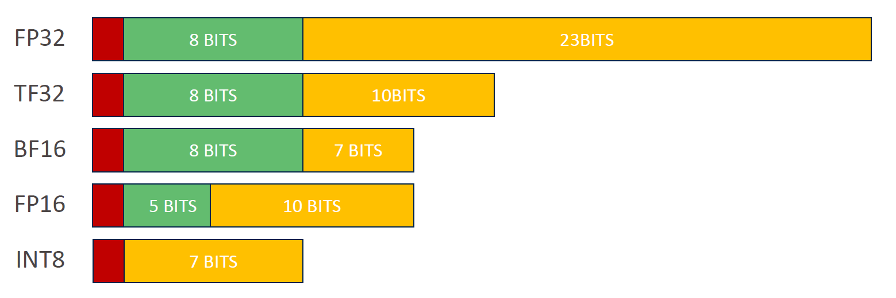

# 量化

## 大纲

0. 大纲
1. 概念

## 1. 概念

:question:什么是量化

神经网络模型由网络拓扑图和一系列权重参数组成，量化即是针对其中的权重参数，采用低精度数据类型。

模型推理通过输入数据与权重参数进行计算，从而得到数据结果；模型训练过程中，权重参数通常为 FP32（32 位浮点）类型，在部署推理过程也采用相同精度，则存在内存占用高、计算速度慢 【量化不一定能加快计算速度：比如，针对高精度，TensorRT 可能采用 Tensor Core 计算；针对低精度，TensorRT 可能采用 Cuda Core 计算，Tensor Core 速度快于 Cuda Core，这种场景量化则并未加快计算速度】、功耗大等问题。故可通过量化技术解决这一系列问题，使得原本只能在高端 GPU 上运行的复杂模型能够部署到资源受限的边缘设备上。

:question:为什么训练的时候用高精度，部署的时候用低精度

:question:不同精度占用的 bit 数，及表示​

## 2. 数学基础

|         | 量化                                                         | 反量化                          |
| ------- | ------------------------------------------------------------ | ------------------------------- |
| INT8    | xq = quantize (x, s) = roundWithTiesToEven (clip (x/s, -128, 127)) | x = dequantize (xq, s) = xq × s |
| FP8E4M3 | xq = quantize (x, s) = castToFP8 (clip (x/s, -448, 448))     | x = dequantize (xq, s) = xq × s |
| INT4    | xq = quantize (x, s) = roundWithTiesToEven (clip (x/s, -8, 7)) | x = dequantize (xq, s) = xq × s |

## 3. 优缺点

- 提升性能，推理速度、吞吐量提升，源于内存带宽需求的降低和计算单元利用率的提高
- 减少内存占用
- 提升功耗效率
- 精度损失
- 模型兼容性要求，并非所有模型架构都能很好地支持量化
- 硬件依赖性，某些量化特性（如 Tensor Core 加速）依赖于特定的 GPU 架构
- 校准复杂性，为了获得最佳的量化效果，特别是 INT8 量化，需要精心准备校准数据集并进行复杂的校准过程，这增加了部署的复杂性和时间成本

## 4. TensorRT 量化

### 4.1 量化类型

- FP16
- INT8
- FP8
- INT4

### 4.2 量化粒度

- **逐张量量化（Per-tensor quantization）**
  - 使用单个缩放值（标量）来缩放整个张量
  - 计算简单，内存开销小
  - 可能因为张量内数值分布不均而导致精度损失
  - 适用于数值分布相对集中的张量，如经过 BatchNorm 处理后的激活值
- **逐通道量化（Per-channel quantization）**
  - 为每个通道单独计算缩放因子，能够更好地适应通道间数值分布的差异
  - 在保持精度方面通常优于逐张量量化，特别是对于权重张量
- **块量化（Block quantization）**
  - 将张量沿单一维度划分为固定大小的 1D 块，为每个块定义一个缩放因子

### 4.3 量化分类

### 4.4 校准

